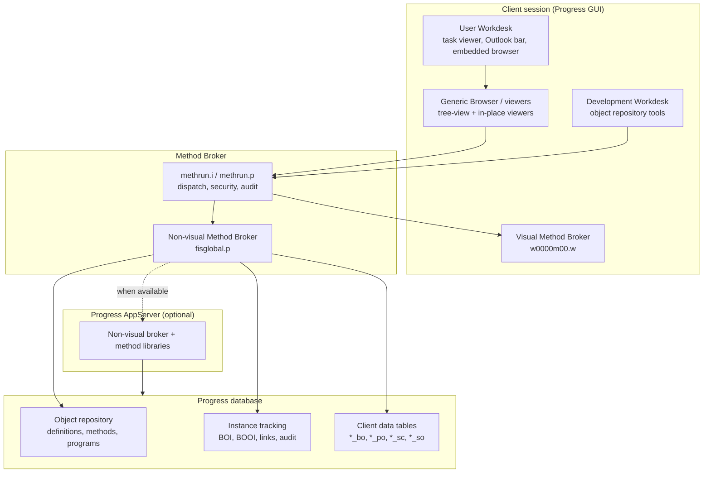
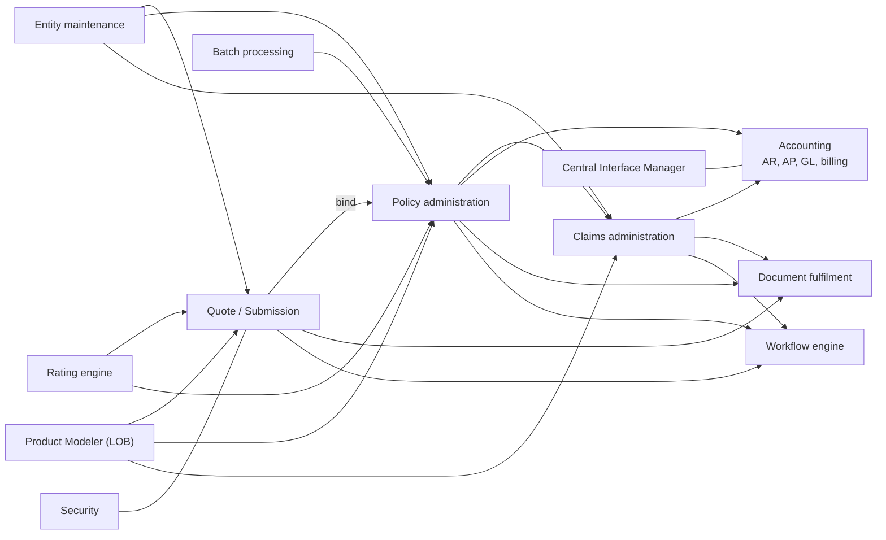

# 01 - System Overview

Sources: *Chapter 1-2* and *About this Help* in `developerhelp.chm`; *FronTier Architecture and Object Definitions.doc* (Sept 2002); *FrontTier Technical Training Agenda.doc*.

## 1. Purpose

FRONT-TIER is an **insurance application framework plus pre-built insurance modules**. It is not a fixed insurance data model. Business entities are stored as reusable *objects*, and each insurer assembles them into its own policy, quote, claim and customer models in a repository. The repository drives the user interface, business logic dispatch, versioning, lifecycle and security at run time, so a new line of business is configured rather than coded.

Business goals stated in the help: increase staff productivity, maximise functionality, mould to business needs, reuse existing hardware and software, simplify maintenance, ease product expansion, follow industry standards.

## 2. Design criteria

| Criterion | Implementation per the documentation |
|---|---|
| Object-oriented model | Encapsulation and polymorphism are provided by the framework, not by the 4GL. Objects interact only by messages through the Method Broker. |
| N-tier | Non-visual processing can be relocated at run time to a Progress AppServer. If none is available the session falls back to 2-tier. |
| Modular, component based | Primary objects are reusable components attachable to any business object. |
| GUI | Windows GUI, tree-view generic browser, tab folders, Outlook-style navigation bar. |
| Database independence | Progress RDBMS. Other databases via Progress DataServer/ODBC are described as available. |
| Open | Generic pre-built interfaces (CIM) for integration. |
| Extensible and customisable | Customer source is delivered for the business architecture; the system architecture is vendor-controlled. |

## 3. Logical architecture

### Runtime components (Source: developerhelp.chm, *Method Broker Application Components*)

| Component | Role |
|---|---|
| `fis-start.p` | Login. Prompts for user and password, optionally opens an AppServer session. Persistently starts the non-visual broker (on the AppServer or locally) and the visual broker (always local). Stores handles in `ghn_appserver`, `ghn_globals`, `ghn_methods`. |
| `i-global.i` | Include defining the three global handles: `ghn_globals` (non-visual broker, `fisglobal.p`), `ghn_methods` (visual broker, `w0000m00.w`), `ghn_appserver`. |
| `fisglobal.p` | Non-visual broker: global session variables, security check before each method, method lookup/run statement (AppServer aware), architecture functions (`genobjfunct.i`, `sysobjfunct.i`), method audit, rating-table lookups. |
| `w0000m00.w` | Visual broker: hidden window; becomes visible in debug mode to trace method calls (temp-table browse), shows globals, holds image lists (16x16 and 32x32), error dialogs, menu building. |
| `methrun.p` / `methrun.i` | Single entry point for all method calls (see [04](04-method-broker.md)). |

## 4. Two interfaces into the system

1. **User Workdesk**: dynamic per user profile. Task viewer (workflow) as home page, application icons populated from the security profile, optional embedded terminal emulators and IE browser via ActiveX.
2. **Batch process access**: external or scheduled processes enter through the same architecture so security and auditing still apply. A batch client must supply a valid user ID and password, can switch to AppServer, and can use dynamic database connections (development, QA and support work areas).

## 5. Environments

| Environment | Capabilities |
|---|---|
| Administration | Security administration, system company, reporting administration, workflow console, document fulfilment, batch process administration, release management |
| Development | Object development tools, dynamic menu/toolbar system, coding templates, generic viewers, debugging tools, ActiveX interfaces, SysDoc generator, help-system interface, release management |

## 6. Business module map

Detail per module is in [06](06-business-modules.md).

## 7. Source tree conventions seen in the documents

| Path (as written in sources) | Content |
|---|---|
| `common/src/apps/` | `methrun.i`, `defvar.i`, `ico00f02.i` (code-table functions) |
| `common/src/dev/` | Development tools, `buffer_count.p`, `s-toolmenu.w`, `s-toolbar.w`, `s-bodef-tree.w` |
| `common/fis-adm/objects`, `fis-adm/method`, `fis-adm/support` | SmartObject sources, `I-fisobject.i`, support programs |
| `c:\ft\dev\<company>\current\<company>\src\apps` | Company UI programs (`bbs-`, `vbm-`, `dbm-`, `vpm-`, `dpm-`, `bpl-`) |
| `...\src\methodlib` | Generated method libraries `<OBJECT-TYPE>.p` |
| `c:\ft\dev\ssq\objdef\` | Export location for object packages (`objdef`) |

## 8. Key observations for an architect *(inferred)*

- The metadata-driven design concentrates risk in the repository tables and the standard method libraries (`bo-stdmethod`, `po-stdmethod`, `so2-`/`sc2-stdmethod`). Any migration must treat these as the real "application".
- Business rules live in generated `.p` method libraries named by convention and registered in `business_definitions_methods`. They are located at run time by `methrun`, not by static reference, so static call graphs will miss them.
- The vendor boundary is explicit: system architecture objects must never be modified by customers and no source is delivered for them, only compile includes.
