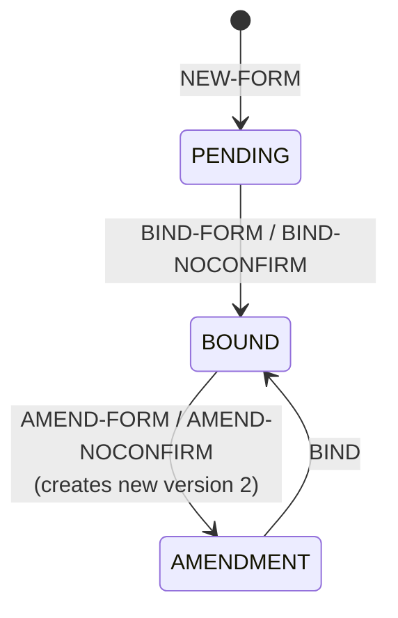

# 02 - Object Architecture

Sources: *FronTier Architecture and Object Definitions.doc*, *FronTier Architecture and Instance Data.doc* (both Sept 2002), developer help chapters 2-5, `botquote_v1*.def`, `Business Object Architecture Tables.pdf`, `System Object Architecture Tables.pdf`.

## 1. Core idea: surrogate keys instead of foreign keys

Traditional schemas link tables with embedded foreign keys (for example `customer_notes.customer_number`), which makes a table unusable in another context. FronTier removes foreign keys from business-data tables. Every business data record carries only a generic **surrogate key** that points to an **instance-tracking record**. Parent/child structure, versioning, lifecycle and links live in the instance-tracking tables. Therefore any data table can be attached to any parent without changing the physical schema.

Each object definition encapsulates three layers that the repository controls together:

1. **Object definition** (metadata in repository tables)
2. **Business logic and presentation** (method libraries and UI programs)
3. **Data storage** (client data tables)

## 2. Two architectures, four object types

| Architecture | Ownership | Container object | Reusable component | Definition tables | Instance tables |
|---|---|---|---|---|---|
| **Business** | Partly vendor, fully customisable, source delivered | **Business Object (B/O)**: policy, quote, customer, claim | **Primary Object (P/O)**: address, note, vehicle, driver | `business_*`, `object_*` | `business_object_instance`, `business_object_obj_inst` |
| **System** | Vendor only, never modify, no source except compile includes | **System Object (S/O)**: system company, user, LOB, ratebook | **System Component (S/C)**: notes, GL accounts, workflow tasks | `system_object_*`, `component_*` | `system_object_instance`, `system_object_obj_inst` |

The two architectures use separate table sets. A business object cannot attach a system component or vice versa. They are joined only by **links** (section 7). System objects were created by copying the business architecture verbatim and renaming it, then using it to build rating, workflow, security and the product modeler.

### Where the definitions live

Development Workdesk (Outlook bar, Development icon) shows System Architecture and Business Architecture trees. Definitions are organised **Class > Type > Definition (version)**.

| Element | B/O table | P/O table | S/O table | S/C table |
|---|---|---|---|---|
| Class | `business_object_classes` | `object_classes` | `system_object_classes` | `component_classes` |
| Type | `business_object_type` | `object_type` | `system_object_type` | `component_type` |
| Definition and attributes | `business_object_definition` | `object_definitions` | `system_object_definition` | `component_definitions` |
| Properties (key/value) | `object_properties` | `object_properties` | `sysobject_properties` | `sysobject_properties` |
| Methods (business logic) | `business_definitions_methods` | `object_definitions_methods` | `system_definitions_methods` | `component_definitions_methods` |
| Programs (presentation) | `business_object_programs` | `object_programs` | `system_object_programs` | `comp_programs` |
| Views | `business_object_view` | n/a | `system_object_view` | n/a |
| Definition links | `business_obj_def_link` | n/a | `system_obj_def_link` | n/a |
| Lifecycle statuses | `business_definitions_status` | n/a | `system_definitions_status` | n/a |
| Status to method map | `business_status_methods` | n/a | `system_status_methods` | n/a |

## 3. Primary objects

A P/O is "a reusable component containing data, business rules and presentation logic capable of functioning independent of the context in which it is used."

**Acceptance test:** you must be able to attach the P/O under any B/O, or under any other P/O, and it must still function (add, modify, delete) with no dependency on its parent or children.

P/O rules:

- P/O instances cannot exist outside a business object. A "note" or "address" must belong to a B/O.
- A P/O definition has **Methods**, **Properties** and **Programs** tabs. Methods can be overridden per use-site; the data table cannot.
- Template base classes when creating a P/O type: `T-GENERAL` (non-versioned data), `T-VERSIONED` (versioned data), `T-LINKED` (no data table, exists only as a link, for example `TINSURER`).

## 4. Business objects

A B/O is a thing active in the business domain. It adds capabilities not found on P/Os:

| Capability | Meaning |
|---|---|
| **Views** | Variants of one B/O. Common data is in the main table; each view may have a 1:1 view-specific table, its own UI programs and method procedure, and a subset of attached P/Os. Example: `ENTITY` with views person, company, insurer, brokerage. |
| **Lifecycle** | Every instance has a status. Different methods are exposed per status. |
| **Versioning** | Copy-on-change versions of instance data (section 6). |
| **Definition links** | Every instance links to one S/O instance, for example a quote linked to its Product Modeler line-of-business definition. |
| **Instance links** | A P/O instance links to another B/O, P/O, S/O or S/C instance (section 7). |

Business object definition dialog fields: Description, Status, Effective, Expiry, Version Data?, Auto New Version?, Track Premium?, Data Table. Tabs: Detail, Methods, Status, Properties, Documents (reserved), Views, Help (reserved), Definition Links, Programs. Effective/Expiry dates are used by the method broker to pick the correct definition version at run time (`inp-asof`).

### Attaching P/Os to a B/O

Each attachment is a row in `business_object_objects` and can override methods and programs, but not the data table.

| Attachment option | Effect |
|---|---|
| Copy when B/O copied (`copyonbocopy`) | Copy P/O instances when the B/O is copied to another B/O type (for example quote to policy) |
| Version Data (`version_data`) | Version the P/O data with the parent |
| Auto New Version (`autonewversion`) | Copy the P/O data record when the parent is versioned |
| Copy on Version (`copytonewversion`) | Copy the architecture record (BOOI) when the parent is versioned |
| Track Premium | Track premium against this P/O |
| Don't Show in Tree / Show Node Only | Generic browser display control |
| Is Mandatory | At least one instance required |
| PO Linked to 1+ objects (`linktoexisting`) | P/O is a link carrier |
| Relationship | `One`, `None, One`, `None, One or Many`, `One or Many` |
| Object Order, Effective, Expiry, Status | Display order and validity |

Per-attachment overrides are stored in `business_obj_obj_methods`, `business_object_obj_programs`, `business_status_obj_methods`, `business_obj_obj_docs`, `business_object_objects_links`.

## 5. Lifecycle (status) model

- `business_object_instance.busobjstatus` is the user-visible status (QUOTE, PROPOSED, BOUND, SOLD, CANCELLED ... in the narrative; PENDING, BOUND, AMENDMENT in the training object).
- `current_status` separately marks the active version (see section 6).
- `business_status_methods` maps each status to the methods exposed at that status. Two reserved pseudo-statuses are system use: `/LINK` and `/UPDATE`. `/UPDATE` must expose only `SAVEUPDATE-INPLACE` and `CANCELUPDATE-INPLACE`; other statuses expose the normal maintenance methods.
- The same mapping exists per attached P/O (`business_status_obj_methods`) and follows the parent B/O status.

### Training lifecycle for TQUOTE



Source: Labs 6 and 7. `LOCAL-BIND-NOCONFIRM` sets `busobjstatus = 'BOUND'`; `CTI-AMEND-NOCONFIRM` creates a new version through `CTI-NEW-VERSION` and sets `'AMENDMENT'`. The exact BOUND-after-AMENDMENT transition is *(inferred)*: the lab binds then amends but only shows the first bind.

## 6. Versioning

Policy data is legally binding, so it must never be edited in place and the system must show what a policy looked like at any date. Traditional systems snapshot the whole policy. FronTier **versions on the object (architecture) side and copies data only when it changes**.

- `business_object_instance` key: `businessobjectnum` (decimal from a DB sequence) + `busobjsequence` (integer, version number).
- Each child P/O instance has a `business_object_obj_inst` row with the same two numbers plus `objectnum`, and a `databusinessobjsequence` that says **which version of the data record** it points to.
- On new version, BOI and BOOI rows are copied (small footprint). Data rows are initially shared (same `databusinessobjsequence`). When a user edits a P/O, only that data record is copied (copy on write) and the BOOI is repointed.

Worked example (from *Architecture and Instance Data*): P/O flags LOCATION (Version Yes, Copy on Version Yes, Auto New Version Yes), ADDRESS (Yes, Yes, **No**). After new version, both BOOI sets exist at sequence 2, location data is copied immediately, address data is copied only when the second address is edited.

Benefits stated: less duplicated data, easy diff (find BOOI rows whose `databusinessobjsequence` equals the version), out-of-sequence transactions can be rolled forward when no conflict, and the generic browser draws history from the object side.

**Version groups** (`version_group`, `firstingroup`): group versions that belong to a term. In the sample, versions 1-5 belong to the first policy term and the renewal becomes version 6 in group 2. The developer decides how to populate the group.

In the documented release both *Version Data* and *Auto New Version* must be enabled on the B/O for versioning to work.

### Creating a version (reference implementation)

```progress
PROCEDURE CTI-NEW-VERSION :
  RUN CTINewVersionBO IN ghn_globals (bo-object-rowid).          /* copies BOI + versioned BOOIs */
  ASSIGN new-bo-rowid = TO-ROWID(RETURN-VALUE).
  IF new-bo-rowid EQ ? THEN DO: ASSIGN out-result = "New Version Failed". RETURN "METHOD-ERROR". END.
  FIND business_object_instance WHERE ROWID(business_object_instance) = new-bo-rowid NO-LOCK.
  RUN BO-NewDataVersion IN THIS-PROCEDURE                        /* copies the B/O data record */
      (old-bo-data-rowid, business_object_instance.busobjsequence,
       business_object_instance.effective, business_object_instance.current_status,
       OUTPUT bo-data-rowid).
  {methrun.i &OBJECT-TYPE='B/O' &OBJECT-ID=bo-desc &METHOD='UPDATE'
             &METHOD-STYLE='NOCONFIRM' &ATTRIBUTE='VISUALID'
             &INPUT-ROWID-A=ROWID(business_object_instance)}    /* refresh visual id */
  ASSIGN out-result = inp-method  out-rowida = new-bo-rowid.
END PROCEDURE.
```

## 7. Linking

| Link kind | Defined where | Stored in | Notes |
|---|---|---|---|
| **Instance link** (P/O to B/O, B/O view, P/O, S/O, S/C) | Attach P/O to B/O, "PO Linked to 1+ objects", then **Links** tab: `business_object_objects_links` | `business_ooinst_links` (`link_bobjectid`, `link_bobjectnum`, `link_busobjsequence`, `link_objectnum`, `link_level`, `link_viewtype`) | Allow Create forces the search dialog when the P/O is created; Allow Update lets the user change the target. Direct B/O-to-B/O links were abandoned as problematic; P/Os are the link points. |
| **Definition link** (B/O definition to S/O instance) | **Definition Links** tab | `business_obj_def_link` | Links every instance to a product definition. Quote -> LOB -> rate book is resolved through helper functions rather than by hand. |
| B/O to B/O relation | API `CtiCreateBOLink` | `business_object_inst_relate` | Programmatic. |

Link level can be B/O, B/O view, or a P/O within a B/O. The linked-P/O pattern (for example `INSURERLINK` or `TINSURER`) holds only data specific to the use on this policy, while the insurer's own data stays in the `ENTITY` B/O.

## 8. Instance management and the generic browser

The generic browser input is the ROWID of a BOI. It reads the definition and instance tables to build the tree-view. Node text is the `visualid` of BOI/BOOI (set by `UPDATE-NOCONFIRM` with `ATTRIBUTE='VISUALID'`), the right pane loads the viewer or list view named in the definition, and the toolbars and menus are generated from methods flagged as menu/toolbar methods valid for the current status. If an object has no instance, only **New** is shown.

## 9. Object packages (release management)

Object definitions export as a **package**: `objectpackage.xml` lists B/O and P/O packages (`OBJECT-PACKAGE-ID`, `OBJECT-COMPANY`, `OBJECT-CLASS`), each `*_v1.xml` lists the repository tables exported (`ba_meta_*`, `business_definitions_methods`, ..., `image_table`, `standard_images`) with `SCHEMA-CRC`, `RECORD-COUNT` and a `.def` data file. Details in [10](10-sample-code-catalogue.md).
