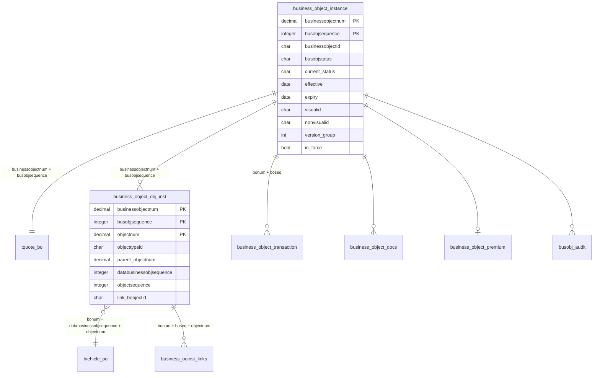

# 03 - Data Model

Sources: *All FronTier Core Tables.pdf* (40 diagram pages, 5 Sept 2002), *Business Object Architecture Tables.pdf* and *System Object Architecture Tables.pdf* (17 Sept 2002), *FronTier Architecture and Instance Data.doc*, `tquote_bo.df`, `tdriver_po.df`, `tvehicle_po.df`.

Table counts below are taken from the PDF diagrams. Field lists are abbreviated to the structurally important columns; the full lists are in the PDFs (and `coretables_compact` working extract).

## 1. Key structure

### Business architecture

| Rule | Detail |
|---|---|
| B/O data row to BOI | One to one. Primary unique index on both is (`businessobjectnum`, `busobjsequence`). A data record never exists without its BOI. |
| `businessobjectnum` | Decimal from DB sequence `businessobjects` (`CtiNextBO`). |
| `busobjsequence` | Integer version number. |
| BOOI | One row per P/O instance. Copies `businessobjectnum` and `busobjsequence` from the parent BOI. `objectnum` is sequential within the B/O (starts at 1, usually preserved across versions, but **never rely on that in queries**). `parent_objectnum` is the parent P/O (0 = directly under the B/O). `objectsequence` is the definition sequence in `business_object_objects`. |
| BOOI to P/O data | `data.businessobjectnum = booi.businessobjectnum` and `data.busobjsequence = booi.databusinessobjsequence` and `data.objectnum = booi.objectnum`. |
| Cardinality warning | Many BOOI rows (different versions) can point to one data row. **Never join from a P/O data row back to BOOI.** Always start from BOOI. |
| B/O sub-tables | Carry the same two key columns plus client key columns (for example `insurer_subbo`). |
| P/O data tables | Three-part key (`businessobjectnum`, `busobjsequence`, `objectnum`). |
| Standard data columns | Templates `generic_bo` (businessobjectnum, busobjsequence, company, change_date, current_status, description) and `generic_po` (adds `objectnum`). New tables are created by copying these fields. |
| Storage areas | `busdata` (data) and `busindex` (indexes). |

### System architecture (same pattern)

`system_object_instance` (`systemobjectnum`, `sysobjsequence`) and `system_object_obj_inst` (`systemobjectnum`, `sysobjsequence`, `objectnum`, `datasysobjsequence`, `compdefsequence`, `comptypeid`), links in `system_ooinst_links`, sequence `systemobjects`. System components are the SC tables (`*_sc`); sub-tables of components are `*_subsc`; sub-tables of system objects are `*_subso`.

### Table naming suffixes

| Suffix | Meaning |
|---|---|
| `_bo` / `_object` | Business object data (main table) |
| `_po` / `_object` | Primary object data |
| `_subbo`, `_subpo` | Sub-table under a B/O or P/O |
| `_so`, `_sc`, `_subso`, `_subsc` | System object, component, and their sub-tables |

## 2. Instance-tracking tables (business)

| Table | Purpose and key columns |
|---|---|
| `business_object_instance` | Master instance record: `businessobjectid`, `visualid`, `effective`, `expiry`, `busobjstatus`, `current_status`, `version_type`, `version_description`, `version_group`, `firstingroup`, `busobjversion`, `originated_from`, `source_busobjsequence`, `in_force`, `virtual_lock*`, `archived*`, `validated_level`, `lifecycle_excluded`, `business_id`, `document_output`, `dc_timestamp` |
| `business_object_obj_inst` | P/O instance: `objecttypeid`, `objectnum`, `parent_objectnum`, `databusinessobjsequence`, `objectsequence`, `visualid`, link fields, `object_status`, `validated_level` |
| `business_ooinst_links` | Instance links: `link_num`, `link_bobjectid/num`, `link_busobjsequence`, `link_objectnum`, `link_type`, `link_level`, `link_viewtype` |
| `business_object_inst_view` | One row per B/O view: `viewtype`, `businessclass`, `searchvalue`, `busobjstatus` (search index) |
| `business_object_inst_involved` | Parties and roles: `involved_id`, `role`, `involved_num` |
| `business_object_inst_relate` | B/O to B/O relationship: `businessobjectnum_a`, `_b`, `relationship` |
| `business_object_inst_conflict` | Out-of-sequence conflict tracking: `pushed_busobjsequence`, `conflict_status`, `pushed_busobjstatus` |
| `business_object_transaction` | Transaction history: `transaction_order`, `transaction_type`, `pre_status`, `post_status`, `transaction_codes`, `transaction_details` |
| `business_object_financial` | Financial entries per B/O: `entry_num`, `entry_type`, `entry_amount` |
| `business_object_docs` | Document requests per instance: `docid`, `language`, `print_status`, `queid`, `outputto`, `printerid`, `emailaddress`, `faxnumber` |
| `busobj_audit` / `busobj_auditdetail` and `object_audit` / `object_auditdetail` | Method audit header and field-level old/new values |

### Premium storage

`business_object_totalprem`, `business_object_premsummary`, `business_object_premium`, `business_object_premdetail` (B/O level) and `business_object_obj_premium`, `business_object_obj_premdetail` (P/O level). Columns: `annual_premium`, `prorated_premium`, `term_premium`, `tally_premium`, `returned_premium`, `adjusted_premium`, `total_discount`, `total_surcharge`, `premium_type`, `premium_order`, `fully_earned`.

Field meanings documented in the object definition: *annual* = premium returned from rate books for one year; *prorated* = rated premium / 365 x days in policy term; *term* = initially the charged premium, recalculated when term expiry changes through adjustment or cancellation; *tally* = last tally - last term + last term adjusted + current term.

## 3. Definition tables (summary)

See [02](02-object-architecture.md) section 2. Additional repository tables:

| Table | Purpose |
|---|---|
| `ba_meta_table`, `ba_meta_field`, `ba_meta_index` (and `sa_meta_*` for system) | Per-object schema extensions used by CIM: attribute names, hidden flags, main table, parent table, table relationship, reporting indexes |
| `method_definitions`, `method_styles`, `method_classes` | Standard method catalogue (method, style, procedure type, visual/default/persistent flags, `can_override`, `return_type`, `db_activity`) |
| `image_table`, `standard_images` | Central image catalogue and standard image to method/object mapping |
| `codetable`, `codetabledata`, `codetablelang`, `codetablegroup` | Generic code tables (versioned, multi-lingual) |
| `menu_block`, `menu_function`, `help_catalog`, `translation_lang`, `bookmarks` | Dynamic menus and toolbars, help, label translation, user bookmarks |
| `error_types`, `error_definition`, `error_log` | Central error messages (IDs like `COMM####`) and run-time log |
| `profiler_*`, `indexReference`, `indexSource` | Application profiler and index-usage analysis |

## 4. Core table catalogue by subject area

Page numbers refer to *All FronTier Core Tables.pdf*.

| Subject area (page) | Tables |
|---|---|
| System component definition (1) | `comp_programs`, `component_classes`, `component_type`, `component_definitions`, `component_definitions_methods` |
| System object definition (2) | `system_object_programs`, `_view`, `_classes`, `_type`, `_definition`, `_objects`, `_links`, `_objects_links`, `_obj_programs`, `_relatedef`, `system_definitions_methods`, `_status`, `system_status_methods`, `system_status_obj_methods`, `system_obj_obj_methods`, `system_obj_defs_help`, `system_obj_def_link`, `sysobject_properties` |
| System object instance (3) | `system_object_instance`, `_obj_inst`, `_inst_view`, `_inst_involved`, `_inst_relate`, `_obj_relate`, `_transaction`, `system_ooinst_links`, `sysobj_audit`, `sysobj_auditdetail`, `component_audit` |
| Standard method definitions (4) | `method_definitions`, `method_styles`, `method_classes` |
| Schedule processing (5) | `printque_so`, `printquedata_subso`, `printqueentry_subso`, `printqueforms_subso`, `printqueheader_subso` |
| Document fulfilment (6) | `documents_po`, `documenthistory_subpo`, `documents_sc`, `documentshistory_subsc`, `docdef`, `docdef_attrib`, `docheader`, `docset`, `docsetdef`, `docsetdoc`, `doctypes`, `extracttype`, `extractdef` |
| Standard S/C data storage (7) | `generic_so`, `generic_sc`, `attachment_sc`, `note_sc`, `journal_sc`, `numbercontrol_sc`, `numbercontrol_subsc`, `attribute_sc` |
| Development support (8) | `translation_lang`, `bookmarks`, `error_*`, `codetable*`, `menu_*`, `help_catalog`, `image_table`, `standard_images` |
| Rating engine (9) | `ratebook_so`, `ratingtable_sc`, `ratingtablefields_subsc`, `ratingtabledata_subsc`, `ratingsttable_sc`, `ratingprocess_sc`, `ratingprocess_subsc`, `ratingprocess_datasubsc`, `ratinginout_sc`, `ratinginout_nodes_subsc`, `ratinginout_attrib_subsc` |
| Security (10) | `systemuser_so`, `secgroup_so`, `secmenu_sc`, `secmethod_sc`, `secfield_sc`, `secthreshold_sc`, `securitylog` |
| Accounting - chart of accounts (11) | `glchart_so`, `glaccount_sc`, `gltrans_subsc`, `glentry_sc`, `glentryitem_subsc` |
| Accounting - system company (12) | `glidentity_sc`, `accountingpref_sc`, `accountingprefyr_subsc`, `termtable_sc`, `billitemcodes_sc`, `billitemrates_subsc`, `billitemapentity_sc`, `paymentplans_sc`, `paymentinstall_subsc`, `paymentmethods_sc`, `claim_codes_sc`, `claims_gldistr_subsc` |
| System company (13) | `systemcompany_so`, `productlicense_sc`, `securitypref_sc`, `assembler_sc`, `router_sc`, `canceltypes_sc`, `docprefs_sc`, `policyprefs_sc`, `device_sc`, `systementityuser_sc`, `customattrib_sc`, `iocontrol_sc`, `iocontroldetails_subsc` |
| Batch processing (14) | `batchprocess_so`, `batchprocesslog_subso`, `batchchildprocess_sc` |
| Product Modeler (15-16) | `lobdef_so`, `lobpolicy_sc`, `loblifecycle_sc`, `loblifecyclecancel_subsc`, `loblifecyclerenewal_subsc`, `loblifecycle_renewal_days`, `lobrating_sc`, `ratebooklink_sc`, `validproducerlink_sc`, `validinsurerlink_sc`, `lobprodcomm_sc`, `lobprodcomm_subsc`, `lobcoverage_sc`, `lobendorsement_sc`, `lobrisk_sc`, `lobdiscounts_sc`, `lobsurcharges_sc`, `lobfactors_sc`, `lobratefactors_sc`, `lobflags_sc`, `lobquestion_sc`, `lobbillitemtype_subsc`, `lobbaserate_table_sc`, `loblimits_table`, `lobdeduct_table_sc`, `lobstat_table`, `lobcovclaim_table_sc`, `lobclaimtypes_sc`, `lobdocdef_table`, `lobreportservers_sc`, `validationdef_sc`, `validationleveldef_sc`, `concerndef_sc`, `concernleveldef_sc` |
| Meta schema extensions (17) | `ba_meta_*`, `sa_meta_*` |
| Primary object definitions (18) | `object_*` |
| Business object definitions (19) | `business_*` definition tables |
| CIM object schema (20) | `ba_schema_definition`, `_businessobject`, `_object`, `_table`, `_field`, `_index` |
| Business object instance (21) | see section 2 |
| Base quote/policy objects (22) | `quote_object`, `policy_object`, `coverage_object`, `endorsement_object`, `discsurch_po`, `flags_po`, `producer_po`, `ratefactors_po`, `ratebookselect_po`, `score_po`, `score_details`, `question_po`, `question_subpo` |
| Validations and concerns (23) | `bovalidation_po`, `validation_subpo`, `validationdata_subpo`, `boconcern_po`, `boconcern_subpo`, `boconcerndata_subpo` |
| Entities (24) | `Entity_bo`, `address_object`, `searchname_po`, `entitylocations_po`, `entityresources_po`, `entitypostions_po`, `entityorgchart_po`, `entityorgchart_subpo`, `entity_link`, `doclibrary_po` |
| Premium storage (25) | see section 2 |
| Policy billing objects (26) | `billingmode_object`, `billingplan_po`, `billingplanitems_subpo`, `billingtrans_po`, `billingitem_subpo`, `paymentmethods_po`, `paymentmethoditem_subpo` |
| Rating test suite (27) | `testsuite_so`, `testrun_so`, `testcase_sc`, `usetestcase_sc`, `testdata_subsc`, `testdatanode_subsc`, `testdataattrib_subsc`, `xmldef_sc`, `xmldefnode_subsc`, `xmldefattrib_subsc`, `expected_subsc`, `actual_subsc` |
| Business development templates (28) | `generic_bo`, `generic_po`, `genericbo_attrib`, `genericpo_attrib` |
| Application profiler (29) | `profiler_session`, `profiler_module`, `profiler_module_line`, `profiler_calltree`, `indexReference`, `indexSource` |
| Original black-box rating objects (30) | `ratingalgorithm_sc`, `ratingphase_sc`, `ratingstep_sc`, `ratingobject_sc`, `ratingitem_sc` |
| Reporting database (31) | `reportdb_so`, `reportdb_schema`, `reportdb_table`, `reportdb_field`, `reportdb_index`, `reportdb_audit`, `reportdb_auditdetail`, `mappingextract_sc`, `mappinglink_sc` |
| Workflow (32) | `processdef_so`, `processinst_so`, `processmodeldef_sc`, `processmodeldef_subsc`, `processtasksdef_sc`, `processtaskinst_sc`, `processtaskinst_po`, `workcell_so`, `cellworker_sc` |
| Base claims (33, 37) | `baseclaim_bo`, `claimevent_bo`, `baseclaimant_po`, `subfile_po`, `claimreserve_po`, `reservechange_po`, `claimpayment_po`, `claimloss_po`, `claimexpense_po`, `claimrecovery_po`, `claimtrans_po`, `lossdetail_po`, `policylink_po`, `clientlink_po`, `claimlink_po`, `claimeventlink_po`, `reportedbylink_po`, `claimamount_subbo/_subpo`, `claimamountdetail_subbo/_subpo` |
| EDI submission (34) | `lobedidef_table`, `editrans_po`, `edisubmission` |
| Accounts receivable (35) | `araccount_so`, `arentries_sc`, `arentriesitem_subsc`, `arinvoice_sc`, `arinvoiceitem_subsc`, `cashreceipt_sc`, `cashreceiptitem_subsc`, `batch_header` |
| Accounts payable (36) | `apaccount_so`, `apentries_sc`, `apentriesitem_subsc`, `appayable_sc`, `appayableitem_subsc`, `disbursement_sc`, `disbursementitem_subsc` |
| Reporting catalog (38) | `reportingcatalog_so`, `reportdef_sc`, `reportdefparam_subsc`, `reportsetup_po`, `reportreq_po`, `reportreqparam_subpo`, `reportsched_subpo`, `reportschedparam_subpo`, `reportparam_subpo`, `reportparamprog_subsc`, `reportsecurity_subpo` |
| JSP development tools (39) | `jspviewer_so`, `jspviewer_sc` |
| CIM mapping object (40) | `mapping_so`, `mappingtable_sc`, `mappingfield_sc`, `query_definition_sc`, `query_details_subsc`, `translationtable_sc`, `translationdata_subsc` |

## 5. Selected business tables in detail

### Quote and policy (page 22)

| Table | Important columns |
|---|---|
| `quote_object` | `quote_number`, `quoteeffective_date/time/ampm`, `quoteexpiry_date`, `current_status`, `named_insured`, `jurisdiction`, `classofbusiness`, `quoted_date/time`, `rated_date`, `rate_valid_until`, `quote_receive_date`, `quote_expire_date`, `lostto`, `bound_businessobjectnum`, `bound_businesobjectid`, `bound_policynum`, `broker_policynum`, `original_inception_date`, `transaction_*`, `originated_from`, `preferred_language` |
| `policy_object` | `policy_number`, `policyeffective_date/time/ampm`, `policyexpiry_date`, `policy_term`, `policycancel_date`, `cancel_method`, `cancel_type`, `cancel_notice_date`, `third_party_cancel_date`, `is_renewal`, `do_not_renew`, `non_renewal_reason`, `renew_app_required`, `renew_inspection_required`, `renew_rce_required`, `renew_uw_review_required`, `allow_reinstatement`, `endorsement_number`, `from_quote_number`, `from_businessobjectid/num`, `from_busobjsequence`, `named_insured`, `jurisdiction`, `classofbusiness`, `rated_date`, `transaction_*` |
| `coverage_object` | `coverage_code`, `coverage_group`, `coverage_limit1/2`, `coverage_deductible1/2`, `currency`, `mandatory`, `base_rate`, `ratetype`, `ratetypeoverride`, `premium_override`, `override_userid/reasoncode/details` |
| `endorsement_object` | `endorsement_id`, `endorsement_group`, `limit1/2`, `deductible1/2`, `mandatory`, rate and override columns as coverage |
| `discsurch_po` | `discountorsurcharge`, `item_id`, `item_value`, `user_overridden`, `user_value`, `ispercentage` |
| `flags_po`, `question_po/subpo`, `score_po/details`, `ratefactors_po`, `ratebookselect_po`, `producer_po` | Risk flags, underwriting questions and answers, scoring, rating factors with overrides, selected rate book (`newer_available`, `uw_approved`), producer commission |
| Validation and concern tables | Validation results by level; concerns (referrals) with `severity`, `concern_status`, `date_resolved`, `resolved_by`, `concern_level` |

### Claims (pages 33 and 37)

| Table | Important columns |
|---|---|
| `baseclaim_bo` | `claimnumber`, `claimseq`, `claimstatus`, `dateofcontract`, `dateofloss`, `causeofloss`, `typeofloss`, `LOBtype` |
| `claimevent_bo` | `Eventnum`, `Eventseq`, `Dateofevent`, `TimeofEvent`, `Eventtype`, `Eventcause`, `Eventstatus` |
| `baseclaimant_po`, `subfile_po` | Claimants and reserve sub-files (`kindofloss`, `subfilestatus`) |
| `claimreserve_po` | `reservetype`, `reserveamount`, `paidamount`, `incurredamount`, `reservestatus`, `reservegroup`, `recovery` |
| `reservechange_po`, `claimtrans_po` | Reserve and claim transactions: `transtype`, `transamount`, `netresult`, `transcode`, approval fields (`createdby`, `approvedby`, `approveddate`), `claimantobjectnum`, `subfileobjectnum`, `reserveobjectnum`, `paymentcategory`, `paymenttype` |
| `claimpayment_po`, `claimloss_po`, `claimexpense_po` | Payments: payee lines, `chequenumber`, `manualcheque`, `chequesource`, `cheque_type`, reversal fields |
| `claimrecovery_po` | Recoveries (`recoverytype`) |
| `claimamount*` | Summaries: reserve, paid, incurred, plus work (`workreserveamount` ...) columns |
| Link P/Os | `policylink_po`, `clientlink_po`, `claimlink_po`, `claimeventlink_po`, `reportedbylink_po` (T-LINKED style, carry only the link) |

### Billing and accounting (pages 11-12, 26, 35-36)

`billingmode_object` (payment plan, bank, credit card, term code, down payment, cash with application), `billingplan_po` (instalments: due date, amount, percent, invoiced flags, overrides), `billingplanitems_subpo`, `billingtrans_po` (transaction, invoicing, AR/AP status), `billingitem_subpo`; AR (`arinvoice_sc`, `arentries_sc`, `cashreceipt_sc` with reversal/NSF/deposit/reconcile batch references), AP (`appayable_sc`, `disbursement_sc`), GL (`glchart_so`, `glaccount_sc`, `gltrans_subsc` source references back to the originating business object, transaction and item).

### Entity (page 24)

`Entity_bo` (name parts, phones, e-mail, web page, `entity_type`, gender, birth date, marital status, `term_code`, `tax_exempt`, `ssn_sin_taxnum`, `sic_codes`, `preferred_language`), `address_object` (typed addresses with county, latitude, longitude), `searchname_po` (alternate names with soundex), `entitylocations_po`, `entityresources_po`, `entitypostions_po`, `entityorgchart_po/subpo`, `entity_link` (entity-to-entity relationships with as-of date), `doclibrary_po`.

## 6. Training tables

| Table | Fields |
|---|---|
| `tquote_bo` ("Very simple quote object") | `businessobjectnum`, `busobjsequence`, `company` (mandatory), `change_date`, `current_status`, `description`, `effective_date`, `expiry_date`, `quote_number`. Indexes: `newprimary` (unique, primary: businessobjectnum, busobjsequence), `effective_date`, `quote_number`. |
| `tdriver_po` ("Basic driver info; my first PO") | `businessobjectnum`, `busobjsequence`, `objectnum`, `company`, `change_date`, `current_status`, `description`, `driver_name` x(100), `driver_license` x(40), `license_class` x(5), `license_year`, `license_month`, `license_province` x(8). Index `newprimary` (unique, primary: businessobjectnum, busobjsequence, objectnum). |
| `tvehicle_po` | key fields as above plus `vehicle_year` (9999), `vehicle_make` x(30), `vehicle_model` x(40). Index `newprimary` (unique, primary: businessobjectnum, busobjsequence, objectnum). |

All use `cpstream=ISO8859-1`.
