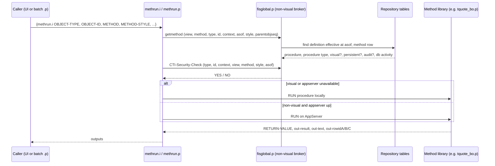

# 04 - Method Broker and Coding Standards

Sources: *Method Broker.doc*, *Methrun Parameters.doc*, *L08 - Common Method Calls.doc*, *Coding Guidelines for FrontTier Methods.doc* (Oct 2002), developer help *Method Run Procedure*, *Input/Output Details and Usage*, *Error Handling*; `tquote_bo.p`, `demo-methrun.p`, `meth*.p`.

## 1. Concept

Objects never touch each other's data. Every operation is a **message** (method call) sent to the **Method Broker**, which finds the right object definition (by `OBJECT-TYPE`, `OBJECT-ID`, view, context and as-of date), checks security, decides whether to run on the client or AppServer, runs the method procedure and returns the result. All calls use the include `methrun.i`.



## 2. Include files

| File | Use |
|---|---|
| `i-global.i` | Global handles (`ghn_globals`, `ghn_methods`, `ghn_appserver`). Optional in callers but normally present. |
| `defvar.i` | **Mandatory**. Defines the `inp-*` / `out-*` variables. Takes `&pre=xx` to prefix every variable (`xxinp-method`, `xxout-result`) so nested calls do not collide. |
| `methrun.i` | Builds and executes the call from pre-processor values. Also accepts `&PRE`. |
| `runparam.i` | Used by `methrun.i` to pass the standard parameters. |
| `definput.i` | Used inside method libraries to receive inputs. |

Only `defvar.i` and `methrun.i` should be used by application code.

## 3. Inputs (pre-processor name / variable)

| Preprocessor | Variable | Type | Meaning |
|---|---|---|---|
| `&OBJECT-TYPE` | `inp-objtype` | char | `B/O` or `P/O` (the CHM also lists `S/O`, `S/C`) |
| `&OBJECT-ID` | `inp-id` | char | `businessobjectid` or P/O `objecttypeid` (for example `TQUOTE`, `ENTITY`) |
| `&CONTEXT` | `inp-context` | char | For a P/O, the B/O it is running in (method overrides) |
| `&METHOD` | `inp-method` | char | `NEW`, `OPEN`, `UPDATE`, ... |
| `&METHOD-STYLE` | `inp-style` | char | `FORM`, `NOCONFIRM`, `DIALOG`, `INPLACE`, `TREEVIEW`, `BROWSER`, `JSP`, `HTML` |
| `&BO-VIEW` | `inp-view` | char | B/O view, for example `INSURER` view of `ENTITY` |
| `&ASOF` | `inp-asof` | date | Date used to choose the definition version; normally `CtiSessionDate()` |
| `&INPUT-LINKLEVEL` | `inp-linklevel` | char | Link target level: `B/O`, view, or P/O |
| `&INPUT-LINKROWID` | `inp-linkrowid` | rowid | Row to link to (BOI or BOOI) |
| `&INPUT-LINKVIEW` | `inp-linkview` | char | View of the linked B/O |
| `&INPUT-ROWID-A` | `inp-rowidA` | rowid | Existing B/O or P/O (BOI or BOOI) the method runs on |
| `&INPUT-ROWID-B` | `inp-rowidB` | rowid | Parent **P/O** (BOOI) when creating a child P/O |
| `&INPUT-ROWID-C` | `inp-rowidC` | rowid | Parent **B/O** (BOI) when creating a P/O |
| `&OUTPUTTO` | `inp-outputto` | char | Printer, e-mail address and so on |
| `&ATTRIBUTE` | `inp-attrib` | char | Free-form attributes, `NAME=VALUE` packed with `CHR(1)` |
| `&procedure-handle` | `save-phandle` | handle | Handle for running an internal procedure in another object |
| `&PARENT-OBJSEQ` | `inp-parentobjseq` | int | Definition sequence of the parent P/O |
| `&ACTION` | `inp-action` | char | DB action accompanying the method |
| - | `inp-text` | char | General input text |

## 4. Outputs

| Variable | Type | Meaning |
|---|---|---|
| `out-result` | char | Method name = success; `CANCEL` = cancelled; any other value = error text (guidelines tighten this to `ERROR`) |
| `out-text` | char | Message text |
| `out-rowidA` | rowid | Resulting BOI (B/O) or BOOI (P/O) |
| `out-rowidB` | rowid | Resulting **data record** (for example `tquote_bo`) |
| `out-rowidC` | rowid | Resulting linked BOOI |
| `out-objectnum`, `out-objectseq`, `out-defobjseq` | int | Object number, object sequence, definition sequence |
| `out-dbaction` | char | Resulting DB action |

Note: source documents disagree on the spelling `out-defobjseq` / `out-defpbjseq` and `iout-rowidc`; these are typographical errors.

## 5. Common calls

```progress
/* new B/O, interactive */
{methrun.i &OBJECT-TYPE='B/O' &OBJECT-ID='TQUOTE' &METHOD='NEW' &METHOD-STYLE='FORM'}

/* new P/O under a B/O */
{methrun.i &OBJECT-TYPE='P/O' &OBJECT-ID='TVEHICLE' &METHOD='NEW' &METHOD-STYLE='NOCONFIRM'
           &INPUT-ROWID-C = ROWID(business_object_instance)}

/* new P/O under another P/O inside a B/O */
{methrun.i &OBJECT-TYPE='P/O' &OBJECT-ID='TDRIVER' &METHOD='NEW' &METHOD-STYLE='NOCONFIRM'
           &INPUT-ROWID-B = ROWID(vehicle_booi)  &INPUT-ROWID-C = ROWID(business_object_instance)}

/* link a P/O to a B/O view with no search dialog */
{methrun.i &OBJECT-TYPE='P/O' &OBJECT-ID='TINSURER' &METHOD='NEW' &METHOD-STYLE='NOCONFIRM'
           &INPUT-ROWID-C = ROWID(business_object_instance)
           &INPUT-LINKLEVEL='B/O' &INPUT-LINKROWID=ROWID(entity_boi) &INPUT-LINKVIEW='INSURER'}

/* refresh the visual id after a data change */
{methrun.i &OBJECT-TYPE='B/O' &OBJECT-ID='TQUOTE' &METHOD='UPDATE' &METHOD-STYLE='NOCONFIRM'
           &ATTRIBUTE='VISUALID' &INPUT-ROWID-A=ROWID(business_object_instance)}

/* select, then open, a system user in the generic browser */
ASSIGN inp-asof = CtiSessionDate().
{methrun.i &OBJECT-TYPE='B/O' &OBJECT-ID='SYSTEMUSER' &METHOD='SELECT' &METHOD-STYLE='DIALOG'}
IF out-rowidA <> ? THEN DO:
  inp-rowida = out-rowida.
  {methrun.i &OBJECT-TYPE='B/O' &OBJECT-ID='SYSTEMUSER' &METHOD='OPEN' &METHOD-STYLE='BROWSER'}
END.
```

Wrap multi-object creation in one transaction so either all objects are created or none (lab question). `demo-methrun.p` demonstrates this pattern (see [10](10-sample-code-catalogue.md)).

## 6. Methods and styles

A method is an operation (`NEW`, `OPEN`, `DELETE`, ...). A **style** is its presentation/execution mode. Every method should exist in a **FORM** (visual) and a **NOCONFIRM** (non-visual) style.

| Style | Purpose |
|---|---|
| `FORM`, `DIALOG`, `INPLACE`, `TREEVIEW`, `BROWSER`, `JSP` | Visual: gather input, confirm, show result |
| `NOCONFIRM` | Non-visual: business logic and database updates, safe for batch/AppServer |
| `HTML` | Produces HTML view (for example `OVERVIEW-HTML`) |

The `TQUOTE` repository export lists 28 methods; a representative set: `ADDBOOKMARK-NOCONFIRM`, `AUDIT-FORM`, `CANCELUPDATE-INPLACE`, `DELETE-{DIALOG,FORM,INPLACE,NOCONFIRM}`, `DIFF-NOCONFIRM`, `EDITBOOKMARK-FORM`, `GETATTRIB-NOCONFIRM`, `HELP-DIALOG`, `NEW-{DIALOG,FORM,NOCONFIRM}`, `OPEN-{DIALOG,FORM,INPLACE,TREEVIEW}`, `OVERVIEW-HTML`, `REMOVEBOOKMARK-NOCONFIRM`, `SAVEUPDATE-INPLACE`, `SEARCH-{DIALOG,TREEVIEW}`, `SELECT-DIALOG`, `SYSATTRIB-NOCONFIRM`, `UPDATE-NOCONFIRM`, `VIEW-{DIALOG,FORM}`.

### Standard method sources

| Source | Content |
|---|---|
| `bo-stdmethod.p` | B/O standard methods, runs as a session super procedure |
| `bo-stdmethod.i` | Include in every B/O method procedure |
| `po-stdmethod.p` / `.i` | P/O standard methods |
| `so2-stdmethod.i`, `sc2-stdmethod.i` | System object and component standard methods |
| `*lifecycle.i` | Quote/policy lifecycle methods and utilities |
| `objfunct.i` | Generic object functions |
| `bomain.i` | Main block: dispatches to internal procedure by method-style, loads `bo-data-rowid` and `bo-object-rowid` for non-NEW methods |

Standard P/O methods: `VIEWLINK-FORM`, `VIEW-FORM`, `SAVEUPDATE-INPLACE`, `SAVELINK-INPLACE`, `OPENLINK-INPLACE`, `OPENLINK-FORM`, `OPEN-INPLACE`, `OPEN-FORM`, `HELP-DIALOG`, `GETATTRIB-NOCONFIRM`, `DELETELINK-NOCONFIRM`, `DELETELINK-DIALOG`, `DELETE-NOCONFIRM`, `DELETE-INPLACE`, `DELETE-FORM`, `COPY-NOCONFIRM`, `CHANGELINK-DIALOG`, `CANCELUPDATE-INPLACE`, `CANCELLINK-INPLACE`, `ADDLINK-NOCONFIRM`, `ADDLINK-DIALOG`.

Standard B/O methods: `BOVIEW-DELETE-NOCONFIRM`, `VIEW-FORM`, `SELECT-DIALOG`, `SEARCH-TREE-VIEW`, `SEARCH-DIALOG`, `SAVEUPDATE-INPLACE`, `OPEN-TREE-VIEW`, `OPEN-TRANS-MEMO`, `OPEN-RELATIONSHIP`, `OPEN-PREMIUM`, `OPEN-INPLACE`, `OPEN-HISTORY`, `OPEN-GLDETL`, `OPEN-FORM`, `OPEN-DOCUMENT`, `OPEN-AUDIT`, `HELP-DIALOG`, `EXPORT-NOCONFIRM`, `DELETE-NOCONFIRM`, `DELETE-INPLACE`, `DELETE-FORM`, `DEBUG-FORM`, `CANCELUPDATE-INPLACE`.

### How a method resolves to code

- Standard version: internal procedure `CTI-<method>-<style>`, for example `CTI-AMEND-NOCONFIRM`.
- Override: internal procedure `LOCAL-<method>-<style>`. `bomain.i` first looks for the `LOCAL-` version.
- New (non-standard) methods: either prefix is allowed; `CTI-` preferred.
- A `LOCAL-` override calls the standard version of the *same* method and style with a plain `RUN CTI-...`. Everything else must go through `methrun.i`, otherwise a recursive chain crashes the call stack.
- The method row (`business_definitions_methods`) records: `procedure_name` (library), `is_visual`, `is_default`, `is_persistant`, `procedure_type` (`External`/`Internal`), `style_status`, `audit`, `audit_data`, `db_activity` (`NEW`, `UPDATE`, `DELETE`, `N/A`), menu attributes (`menu_method`, `menu_label`, `menu_order`, `toolbar_method`, `imagevalue`, `tooltip`, `valid_status` such as `/LINK`, `/UPDATE`, `*`), `changestatusto` (future use), `trigger_print`, `validwhenlocked`, `pre_method_program`, `messageText`.

## 6a. Method-library skeleton (from `tquote_bo.p`)

```progress
{i-global.i}          /* handles of the method broker */
{definput.i}          /* standard method inputs */
DEFINE VARIABLE bo-dialog     AS CHARACTER INITIAL "dbm_tquote.w"       NO-UNDO.
DEFINE VARIABLE search-dialog AS CHARACTER INITIAL ""                   NO-UNDO.
DEFINE VARIABLE bo-window     AS CHARACTER INITIAL "wbm-generic_bo.w"   NO-UNDO.
DEFINE VARIABLE bo-desc       AS CHARACTER INITIAL "TQUOTE".
&SCOPED-DEFINE BO-OBJECT  tquote_bo
&SCOPED-DEFINE BO-DISPLAY 'Quote:' + tquote_bo.quote_number
{objfunct.i}
{bo-stdmethod.i}
{bomain.i}            /* loads bo-data-rowid, bo-object-rowid; dispatches CTI-/LOCAL- procedure */
/* PROCEDURE CTI-AMEND-FORM / CTI-AMEND-NOCONFIRM / CTI-NEW-VERSION / LOCAL-BIND-* / LOCAL-NEW-FORM ... */
```

For a P/O the equivalents are `&SCOPED-DEFINE PO-OBJECT <table>`, `&SCOPED-DEFINE PO-DISPLAY <field>` and `po-dialog`. For a linked P/O with no table, comment out `PO-OBJECT`/`PO-DISPLAY` and set `po-dialog` to `""`.

## 7. Coding guidelines (Oct 2002)

### Problems the guidelines address
Poor UI control (no hourglass or completion dialog); inconsistent error handling so partial commits go undetected; little explicit transaction control and few `NO-UNDO`; business logic inside visual methods (blocks AppServer and batch use); no standard way to pass attributes so procedure-scoped variables were abused; non-visual methods returning `METHOD-ERROR` which makes the broker pop an error dialog and breaks batch/AppServer execution.

### Structure and naming

| Object | Default method procedure | Specialised procedure |
|---|---|---|
| Business object | `<businessobjectid>_bo.p` (`autopolicy_bo.p`) | `<boid>_<method>.p` (`autopolicy_bind.p`) |
| B/O view | `<viewtype>_bo.p` | `<viewtype>_<method>.p` |
| Primary object | `<poid>_po.p` (`notes_po.p`) | `<poid>_<method>.p` |
| P/O override in a B/O | `<boid>_<poid>.p` (`autopolicy_notes.p`) | `<boid>_<poid>_<method>.p` |
| P/O override in a view | `<viewtype>_<poid>.p` | `<viewtype>_<poid>_<method>.p` |
| System object / component | `<soid>_so.p`, `<scid>_sc.p` | `<soid>_<method>.p` |
| Component override | `<soid>_<scid>.p` | `<soid>_<scid>_<method>.p` |

(The training labs generate `tquote.p`, `tdriver.p`, `tvehicle.p`, `tinsurer.p` through the template, and the sample file in the share is named `tquote_bo.p`; the tool's generated name follows the *Default Method Lib* field.)

Other rules: lower-case procedure names and `RUN` statements (Unix portability). Smaller procedures load faster and are more stable. Keep to one method procedure per object but split when over about 15 table buffers in the main block or many internal procedures (for example from a lifecycle include). Measure with `common/src/dev/buffer_count.p` (output `buffer_count.txt`, paths hard-coded): 15-20 buffers is the upper limit and above 25-30 unpredictable instability with memory symptoms was observed. Prefer local variables and buffers in internal procedures. Declare all variables `NO-UNDO`.

### Method calling
- Use `methrun.i` for every call to another method, even within the same file. This preserves AppServer routing and prevents shared variables or buffers.
- Never call a visual method from a non-visual one.
- Do not use `SESSION:SET-WAIT-STATE` in non-visual methods or in utilities.

### Passing attributes
Pack into `inp-attrib` or `inp-text` as `NAME=VALUE` separated by `CHR(1)`. Both a visual dialog and a batch program can then call the same non-visual method. The CIM `EXTRACT` method uses this. Never use procedure-scoped variables to share state between methods.

### Return conventions

| | Visual method | Non-visual method |
|---|---|---|
| `RETURN-VALUE` | `" "` ok, `"CANCEL"`, `"ERROR"`, `"METHOD-ERROR"` (broker shows a dialog; standard for NEW-FORM, OPEN-INPLACE) | `" "` ok, `"ERROR"` only. Never `METHOD-ERROR` |
| `out-result` | method name, `" "`, `"CANCEL"`, `"REFRESH"`, `"REFRESH CURRENT"`, `"REFRESH PARENT"`, `"ERROR"` | method name, or `"ERROR"` |
| `out-text` | error text when `ERROR` | meaningful error message when `ERROR` |

Refresh semantics for the generic browser: method name or `" "` refreshes the current node; `CANCEL` no refresh; `REFRESH` whole tree; `REFRESH CURRENT` current node and children; `REFRESH PARENT` parent node and its children.

Never ignore a called method's `RETURN-VALUE` and `out-result`. A non-visual caller copies the child's `out-result` and `out-text` and returns `"ERROR"`; a visual caller shows a dialog with method, style, return value, result and text.

### Transactions
Use an explicit `DO TRANSACTION` block with `ON ERROR / ENDKEY / STOP / QUIT UNDO ..., LEAVE ...` inside the non-visual method only. Never in a visual method (visual methods must not update the database and Progress transactions cannot span client and AppServer).

### Templates

Visual (`CTI-xxx-FORM`): local buffers; `{defvar.i &PRE=child}`; confirmation dialog (`RETURN "CANCEL"` on cancel); pack `&ATTRIBUTE`; `SESSION:SET-WAIT-STATE('General')`; `{methrun.i &PRE=child ... &METHOD-STYLE='NOCONFIRM'}`; reset wait state; if `RETURN-VALUE` is `METHOD-ERROR` or `ERROR`, or `childout-result` differs from `childinp-method` and is not `CANCEL` or blank, show an error dialog (method, style, exit status, return value, message) and `RETURN "ERROR"`; on success show info dialog, set `out-result = inp-method`, `RETURN ""`; on cancel set `out-result = "CANCEL"`, `RETURN "CANCEL"`.

Non-visual (`CTI-xxx-NOCONFIRM`):

```progress
PROCEDURE CTI-TEMPLATEMETHOD-NOCONFIRM:
  DEFINE BUFFER xxx FOR yyy.
  {defvar.i &PRE=child}
  DEFINE VARIABLE returnValue AS CHARACTER NO-UNDO.
  ASSIGN returnValue = "ERROR" out-result = "ERROR"
         out-text = "Unexpected error in " + inp-method + "-" + inp-style.   /* default for untrappable errors */
  mainBlock:
  DO TRANSACTION ON ERROR UNDO mainBlock, LEAVE mainBlock
                 ON ENDKEY UNDO mainBlock, LEAVE mainBlock
                 ON STOP UNDO mainBlock, LEAVE mainBlock
                 ON QUIT UNDO mainBlock, LEAVE mainBlock:
    {methrun.i &PRE=child &OBJECT-TYPE='...' &OBJECT-ID='...' &METHOD='...' &METHOD-STYLE='...'
               &INPUT-ROWID-A=ROWID(...)}
    IF (RETURN-VALUE = "METHOD-ERROR") OR (RETURN-VALUE = "ERROR")
       OR (childout-result <> childinp-method AND childout-result <> "") THEN DO:
      ASSIGN out-result = IF (childout-result = "" OR childout-result = ?) THEN "ERROR" ELSE childout-result
             out-text   = IF (childout-text   = "" OR childout-text   = ?)
                          THEN "Unexpected error in method " + childinp-method + "-" + childinp-style
                          ELSE childout-text
             returnValue = "ERROR".
      UNDO mainBlock, LEAVE mainBlock.
    END.
    ASSIGN returnValue = "" out-result = inp-method out-text = "".
  END.
  RETURN returnValue.
END PROCEDURE.
```

Template defect to be aware of: the non-visual template references `localinp-method` and `localinp-style` in its error text while the declared prefix is `child`. Use `childinp-method` / `childinp-style`.

## 8. Global/session functions the broker exposes

`CtiSessionDate()`, `CtiSessionTime()`, `CTIAuditDate`, `CTIAuditTime`, `CTIGetGlobal(name)`, `setglobal`, `showglobal`, `CTI-Security-Check`, `getmethod`, `CTIGetError`, `CtiGetSoundex`, `CTISearchSource`, `CompareTables`. Full table in [09](09-api-reference.md).

## 9. Error message handling

Central store of messages: `error_types` and `error_definition` (`error_id` such as `COMM####`, text, severity, suggestion, `logerror`). Code calls `ctimessage.p` (called `citmessage.p` in places in the source) with an error ID, text or both. If the ID is new the user may add it to the table; if it exists the dialog (`dveerrt0.w`) offers drill-down plus system information (`b-systeminfo.w`). IDs must be unique because lookup is by ID only; a duplicate ID causes the new text to be ignored. Error maintenance has a search by ID (`wceermn1.w`, `d-geterror-id.w`). Handling is split between visual and non-visual brokers so it works on the AppServer.

## 10. Debugging and audit

Debug mode makes `w0000m00.w` visible and records every method call in a browsed temp-table. Per-method audit is controlled by `audit` and `audit_data` flags and recorded in `busobj_audit` / `busobj_auditdetail` (field level old/new value) or `object_audit` and `sysobj_audit`.
