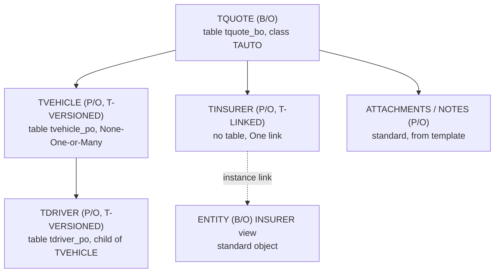

# 05 - Development Guide

Sources: Labs L01-L08 (`Architecture Overview` and `The Method Broker` folders), `FrontTier Technical Training Agenda.doc`, developer help chapters 4-6, sample files. The training builds a motor **quote** `TQUOTE` with vehicles, drivers and a linked insurer.

## 1. Course structure

| Day | Topic |
|---|---|
| 1 | Object architecture overview: object types, repository (Development Workdesk), views, lifecycle, versioning, methods, definition and instance links, object models, definition and instance data storage, instance management (generic browser) |
| 2 | Business object development: workdesk, definition, database, AppBuilder integration, method library, viewers, queries, dialogs, frames, list view, linking, lifecycle, versioning, methods, status |
| 3 | Primary object development |
| 4 | Instance management in 4GL: `methrun`, instance queries |

Target model for the labs:



`botquote_v1busobjob.def` (the shipped export of `TQUOTE`) contains only two attachments, `ATTACHMENTS` (sequence 2) and `NOTES` (sequence 5), both "None, One or Many". The `TVEHICLE`, `TDRIVER` and `TINSURER` attachments built in Lab 4 are **not** in that export, so the package reflects the object before or without Lab 4 (see [12](12-source-inventory-and-gaps.md)).

## 2. Naming conventions

| Artifact | Pattern | Example |
|---|---|---|
| Data table (B/O) | `<name>_bo` | `tquote_bo` |
| Data table (P/O) | `<name>_po` | `tdriver_po` |
| Method library | `<object-type>.p` | `tquote.p` (generated); training sample `tquote_bo.p` |
| B/O search browser | `bbs-<BO type>.w` | `bbs-tquote.w` |
| B/O viewer | `vbm-<BO type>.w` | `vbm-tquote.w` |
| B/O update dialog | `dbm-<BO type>.w` | `dbm-tquote.w` |
| B/O search dialog | `dbs-<name>.w` | `dbs-generic.w` |
| P/O list view browser | `bpl-<P/O id>.w` | `bpl-tvehicle.w` |
| P/O viewer | `vpm-<P/O id>.w` | `vpm-tvehicle.w` |
| P/O dialog | `dpm-<P/O id>.w` | `dpm-tvehicle.w` |
| Menu launcher | `pstr<bo>.p` | `pstrtquote.p` |
| Object class/type/id | upper case, unique | `TAUTO`, `TQUOTE`, `TVEHICLE` |

Company code in the training exports is `SSQ`; `Sherwood` is used in the narrative paths.

## 3. Lab 1: define a business object

1. **Data table** `tquote_bo` in the Progress Data Dictionary: storage area `busdata`, copy all fields of `generic_bo`, add `effective_date` (date, indexed), `expiry_date`, `quote_number` (x(60), indexed), add index `newprimary` (primary, unique, active, on `businessobjectnum`, `busobjsequence`, area `busindex`). Commit. Shortcut: load `tquote_bo.df`.
2. **Class**: Development Workdesk > Business Architecture > Business Object > New. Company, Object Class (unique in company, here `TAUTO`), Description, Effective, Expiry, Status, Template Class?.
3. **Type**: Business ID `TQUOTE` (unique across classes), Description, Type Status, **Base BOID** `T-GENERAL` (template class supplying default method calls), Default Method Lib `<OBJECT-TYPE>.p` (created in `\MethodLib`).
4. **Version/definition**: ellipsis on Data Table > Schema Maintenance > Add Tables > select `tquote_bo` (becomes main table, 1:1 with `business_object_instance`). Choose standard image `Quote`. Save.

## 4. Lab 2: business object user interface

1. **Search browser** (AppBuilder template *CTIV8-Bo Search Browser Wizard*): query on `business_object_instance` + `tquote_bo` where `businessobjectid = 'TQUOTE'`; columns `busobjstatus`, `description`, `effective_date`, `expiry_date`, `quote_number`. In Definitions set `bo-typeid = "TQUOTE"`, `bo-view = ""`. Save as `bbs-tquote.w`. Register on the B/O **Programs** tab as `SearchBrowser`.
2. **Menu icon**: Development > Dynamic Menu Maintenance > `fis-workdesk` > Applications > New Item (order low so it appears first). Menus are built at start-up so log out and in. The item runs `pstrtquote.p`, which calls `{methrun.i &OBJECT-TYPE='B/O' &OBJECT-ID='TQUOTE' &BO-VIEW='' &METHOD='SEARCH' &METHOD-STYLE='TREEVIEW'}`.
3. **Viewer** (*CTIV8-BO Viewer*): table `tquote_bo`, fields `quote_number`, `effective_date`, `expiry_date`, `description`; add `business_object_instance.busobjstatus` and disable it (maintained automatically). Save `vbm-tquote.w`. Register as `Viewer`.
4. **Update dialog** (*CTIV8-BO Update Dialog*): change master file of the embedded SmartViewer to `vbm-tquote.w`; set `&SCOPED-DEFINE BO-DATA-FILE tquote_bo`; save `dbm-tquote.w`; edit the `UpdateDialog` program row from `dbm-generic_bo.w` to `dbm-tquote.w`. Replacing the viewer through *Properties > Master File* keeps the SmartLinks, whereas deleting and re-adding a viewer would lose them.

Registered programs for `TQUOTE` (`botquote_v1boprogra.def`): `bbs-tquote.w` SearchBrowser, `dbs-generic.w` SearchDialog, `dbm-tquote.w` UpdateDialog, `vbm-tquote.w` Viewer.

## 5. Lab 3: primary objects

1. **Tables** `tdriver_po` and `tvehicle_po` from `generic_po` plus fields, `newprimary` index on `businessobjectnum`, `busobjsequence`, `objectnum`.
2. **Class** `TAUTO` (Primary Object), **Type** with base class `T-VERSIONED`, method library `tdriver.p`; **Definition** with the data table through Schema Maintenance (1:1 with `business_object_obj_inst`) and standard image.
3. **Method library edits** in AppBuilder (opened through the FronTier tool, not the Progress menu): `&SCOPED-DEFINE PO-OBJECT tdriver_po`, `&SCOPED-DEFINE PO-DISPLAY tdriver_po.driver_name`.
4. Exercise 1: repeat for `TVEHICLE` (display field not given in the lab).
5. Exercise 2: `TINSURER` as `T-LINKED`, **no data table**, comment out `PO-OBJECT` and `PO-DISPLAY`, set `po-dialog` initial value to `""`.

Exported definition (`potdriver_v1object_t.def`): company `SSQ`, class `TAUTO`, type `TDRIVER`, description "Training Driver PO", base `T-VERSIONED`, library `tdriver.p`; `potinsurer_v1object_t.def` has base `T-LINKED`, library `tinsurer.p`.

## 6. Lab 4: assemble the business object

Right-click the `TQUOTE` definition node > New > pick class TAUTO and P/O.

| Link | Parent in tree | Relationship |
|---|---|---|
| `TQUOTE` -> `TVEHICLE` | `TQUOTE` definition | One-to-many (None, One or Many) |
| `TQUOTE` -> `TINSURER` | `TQUOTE` definition | One-to-one; then **Links** tab > Add Link > `ENTITY` B/O (view `INSURER`) |
| `TVEHICLE` -> `TDRIVER` | `TVEHICLE` node | One-to-many |

## 7. Lab 5: primary object UI

- **List view browser** (*CTIV8-PO Listview Browser*): shown when the user selects the P/O node. Default shows only `business_object_instance.visualid`. In Definitions set `PO-OBJECT` to the table; set display fields in the `DISPLAY` trigger of `br_table`; the `OPEN_QUERY` trigger can drop lines intended for P/Os with links to improve performance. Save as `bpl-tvehicle.w`.
- **Viewer** (*CTIV8-PO Viewer*, `vpm-tvehicle.w`) and **dialog** (*CTIV8-Update Dialog*, `dpm-tvehicle.w`; set `PO-DATA-FILE`).
- Register on the P/O definition **Programs** tab for all B/Os, or on the **Program override** of the P/O under a specific B/O when it differs.
- **Methods visible on the screen** depend on status methods: status `/LINK` ignored; status `/UPDATE` only `SAVEUPDATE-INPLACE`, `CANCELUPDATE-INPLACE`; all other statuses `NEW-FORM`, `OPEN-FORM`, `OPEN-INPLACE`, `DELETE-FORM`, `DELETE-INPLACE`, `VIEW-FORM`. Ensure the menu and toolbar flags are set on the method row. When no instance exists only **New** appears.

## 8. Lab 6: lifecycle with versioning

1. Add object method codes to the generic code table: Generic Table Maintenance > Object Tables Group > `OBJECTMETHOD` > version; new entry `AMEND`.
2. On the `TQUOTE` Methods tab add `AMEND-FORM`, `AMEND-NOCONFIRM`, `BIND-FORM`, `BIND-NOCONFIRM`.
3. On the Status tab add statuses `PENDING`, `BOUND`, `AMENDMENT`; for each use the blue globe icon on the Method toolbar to select its methods.
4. Update the method procedure to implement the lifecycle (`CTI-AMEND-*`, `LOCAL-BIND-*`, `CTI-NEW-VERSION`; see `tquote_bo.p` in [10](10-sample-code-catalogue.md)). `LOCAL-NEW-FORM` runs `CTI-NEW-FORM` then sets the status.

## 9. Lab 7: querying the object model

Queries are plain 4GL against the tables. Pattern for "find P/O data of a B/O" always starts at BOI and BOOI, never at the P/O table:

```progress
FOR EACH tquote_bo NO-LOCK WHERE tquote_bo.quote_number = '1234',
    FIRST business_object_instance OF tquote_bo NO-LOCK
          WHERE business_object_instance.busobjstatus = 'BOUND',
    EACH  business_object_obj_inst NO-LOCK
          WHERE business_object_obj_inst.businessobjectnum = business_object_instance.businessobjectnum
          AND   business_object_obj_inst.busobjsequence    = business_object_instance.busobjsequence
          AND   business_object_obj_inst.objecttypeid      = 'TVEHICLE',
    FIRST tvehicle_po NO-LOCK
          WHERE tvehicle_po.businessobjectnum = business_object_obj_inst.businessobjectnum
          AND   tvehicle_po.busobjsequence    = business_object_obj_inst.databusinessobjsequence
          AND   tvehicle_po.objectnum         = business_object_obj_inst.objectnum:
  DISPLAY tvehicle_po.vehicle_make tvehicle_po.vehicle_model.
END.
```

Lab questions covered: all quotes with `effective_date >=` a date including multiple versions per `businessobjectnum`; latest version of a quote number; vehicles in the `AMENDMENT` version; vehicles copied to the second version (both architecture and data rows); vehicles by year or make; drivers of vehicles in `BOUND` vs `AMENDMENT` (BOOI `busobjsequence` is 2 while `databusinessobjsequence` stays 1, which is the lab's "explain why": data was not changed so it is shared); drivers by class `G2`; ENTITY linked through `TINSURER` (via `business_ooinst_links`, then `entity_bo` and `address_object`); quotes linked to an entity name.

Link walk (from `mapping.p`, `INSURER_NAME`): get BOOI for `TQUOTE_TINSURER`, `FIND FIRST business_ooinst_links OF business_object_obj_inst`, then `entity_bo` where `businessobjectnum = link_bobjectnum` and `busobjsequence = link_busobjsequence`.

## 10. Lab 8: programmatic method calls

Exercises: (a) create a `TQUOTE` with two vehicles and two drivers using `NEW-FORM` calls; (b) do the same with no user interaction using `NEW-NOCONFIRM`. Questions: how to detect a Cancel (check `out-result = "CANCEL"` as well as `RETURN-VALUE`); how to make creation all-or-nothing (one outer transaction with undo on any child error). The `Queries` and `The Method Broker` sample programs implement these.

## 11. Overriding standard methods

1. Open the method library in AppBuilder; add internal procedure `LOCAL-DELETE-FORM` (or the relevant `LOCAL-<method>-<style>`).
2. Save under a new name in `...\methodlib` (example `entity_bo1.p`).
3. In the Development Workdesk open the method row (Methods tab > Open) and change **Procedure** to the new file.

## 12. Development support tooling

- Coding templates: B/O, P/O, S/O, S/C maintenance dialog, viewer and query; B/O search browser.
- Debug: visual method broker window, method audit, `buffer_count.p`, profiler tables.
- Help system: create a help catalog entry, attach to a B/O Help tab, *Generate* to produce HTML then compile to CHM.
- SysDoc generator: HTML system documentation generated from the repository using the HTML report generator.
- Release management module: releases, issues and tasks, release notes; object export/import packages.
- Dynamic menu: the Menu Tree Maintenance defines menu blocks, items, toolbar flag, image, function type, order.
