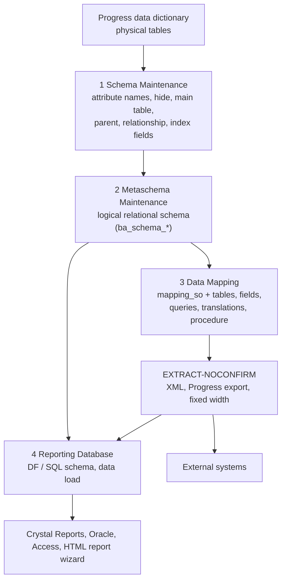

# 07 - Central Interface Manager (CIM) and Reporting Database

Sources: *Central Interface Manager User Guide.pdf* (48 pp), *How to use Reporting Database.pdf* (28 pp), `CIM_USER_HELP.chm` (189 files, overlaps the PDFs), `mapping.p`, `mapping_so_extract.p`, `mapping_tquote_extract.p`.

## 1. Purpose

CIM is the single point through which data is imported or exported to external systems and the basis for reporting databases. Design objectives: hide the object architecture from end users; provide tools to build data warehouses or decision-support databases from FronTier data; extract and import without knowledge of the physical schema.

Reasons given for a separate reporting database: the surrogate-key structure is hard for non-technical users, indexes are tuned for data entry not reporting, table and field names are not business friendly, many reporting tools cannot read Progress, and reporting tools cannot hide sensitive tables and fields.

## 2. Schema Maintenance module

Launched from the **Data Table** ellipsis of any B/O, B/O view, P/O, S/O or S/C definition. Tables must still be created in the Progress data dictionary; the dialog only adds properties to existing tables and fields.

| Button | Function |
|---|---|
| Add Tables / Remove Tables | Attach or remove object data tables (architecture tables cannot be removed) |
| Set Main Table | Mark main data table (not an architecture table). Others are sub-tables |
| Select Parent / Set Table Relationship | Parent-child and cardinality (none/one/many) between data tables |
| Hide / Expose Tables and Fields | Exclude from metaschema, mappings and extracts |
| Update Schema | Re-sync fields and properties with the Progress schema (do after any dictionary change) |
| Select Index Fields | Define additional non-primary reporting indexes |

Table properties: **Attribute Name** (used to build metaschema table names), **Description**. Field properties: Attribute Name, Description, Hide?, Display Order. Keep table attribute names short because the final name concatenates parent attribute names and many databases limit identifiers to about 32 characters.

Architecture tables automatically included in every object schema:

| Object | Architecture tables |
|---|---|
| B/O | `business_object_instance`, `_premium`, `_totalprem`, `_premdetail`, `_premsummary` |
| P/O | `business_object_obj_inst`, `business_object_obj_premium`, `business_object_obj_premdetail` |
| S/O | `system_object_instance` |
| S/C | `system_object_obj_inst` |

Save of the object dialog saves both definition and schema changes; Cancel undoes both.

## 3. Metaschema module

A **metaschema** is a logical relational view of the physical object schemas, generated from selected B/Os and S/Os. Recommended: one metaschema containing **all** B/O and S/O definitions so every link field is generated (link fields appear only if both ends are in the metaschema). Rebuild whenever tables or components are added/removed, parent-child relationships change, or premium tracking is toggled.

**Merging rules**

1. Merge tables with a 1:1 relationship into one logical table (all fields combined).
2. Create parent/child logical tables for 1:many.
3. Two objects in 1:1: merge the child object's main table into the parent's main table.
4. Two objects in 1:many: child main table is 1:many to the parent main table.

**Logical table names**

| Source | Name |
|---|---|
| B/O main table | B/O view + B/O main table attribute |
| B/O sub-table | B/O view + B/O main attr + sub-table attr |
| P/O main table | B/O view + B/O main attr + parent P/O attr + P/O attr + P/O definition sequence |
| P/O sub-table | B/O view + B/O main attr + parent P/O attr + parent definition sequence + sub-table attr |

**Fields**: name from the field attribute (physical name if blank), unique within table (sequence appended). Only architecture key fields (`businessobjectnum`, `busobjsequence`, `objectnum`, `parent_objectnum`) are carried into data tables.

**Indexes**: each logical table has a unique primary index of the architecture keys (B/O: bonum, boseq; P/O adds parent_objectnum, objectnum; sub-tables append the sub-table's main index fields). Other indexes defined in Schema Maintenance are copied unmodified.

**Identifier rules** by schema format: truncated to maximum length, spaces become `_`, invalid characters removed, reserved words prefixed with `X`, duplicates get a sequence number.

**Maintenance dialog** (Development > Metaschema Maintenance): Schema ID, Schema Format (SQL syntax, name length, valid characters, reserved words), Schema Type (always use `RELATIONAL`; non-relational types generate outer joins and perform badly), Description, Log File Name. Buttons: Business Objects, System Objects, Create Schema (rebuilds from scratch; writes `.log`, `.lst`, `.e`), Delete Schema (orphans dependent mappings and reporting databases), Create Mapping, Export Definition (XML and a Word document per schema table).

## 4. Data mapping module

A mapping is built on one metaschema and **one business or system object**; it defines a query used for export and import (current extract formats: XML, Progress/Oracle delimited, fixed width, XML pointer).

| Element | Table | Notes |
|---|---|---|
| Mapping | `mapping_so` | `mapping_id`, `schema_id`, description, comments; main table; optional **mapping procedure** |
| Mapping table | `mappingtable_sc` | Metaschema table with a unique mapping table name (XML element name, or `.d` file name for Progress format), order, optional procedure |
| Mapping field | `mappingfield_sc` | Metaschema or **calculated** field; order; data type; default; allow null; read only; hidden; translation table; calculation procedure and parameters |
| Query | `query_definition_sc`, `query_details_subsc` | At most one per mapping table; AND/OR tree of expressions; operators begins, equals, greater than, less than, not begins, not equals, not greater than, not less than |
| Translation table | `translationtable_sc`, `translationdata_subsc` | Convert values on import/export (for example logical to "Active"/"Inactive"), with default and data type |

Mapping procedure rules: run **persistently** for the duration of an extract; internal procedures named in calculated fields take `INPUT lParameters CHARACTER` and `OUTPUT lFieldValue CHARACTER`; return `'ERROR'` to export the field default. The extract supplies `getTableRowid(object type, object id, physical table, mapping table, OUTPUT rowid)`, `writeLogEntry(text)` and `writeErrorLog(text)`. Only the tables of the current and ancestor query branches are available, and data tables only if at least one field is mapped from them.

Field processing order: value (query or calculated) -> default if undeterminable -> translation lookup (translation default if missing) -> null check: if *Allow Null* export `?`, else log an error.

Mapping queries use translated values and the translation data type when a field has a translation table.

Other functions: Validate (checks tables/fields exist in metaschema and physical schema, lists failures with Open/Delete), ExportDef (XML, SQL, DEF, CTL files).

## 5. EXTRACT methods and attributes

`EXTRACT-NOCONFIRM` on the **MAPPING S/O** is the primary method. `EXTRACT-FORM` (mapping and every B/O) and `EXTRACT-NOCONFIRM` on B/Os all call it. On a B/O, if `MAPPING_ID` is omitted the method uses the mapping named like the B/O (or `<view>_<B/O>`); no mapping gives a method error.

| Attribute | Default | Meaning |
|---|---|---|
| `MAPPING_ID` | derived | Mapping to use (B/O method) |
| `OBJECT_ROWID` | all | Extract one instance (string of `business_object_instance` rowid) |
| `OBJECT_TYPE` | | `B/O` or `S/O` for the rowid |
| `OBJECT_ID`, `OBJECT_VIEW` | all | Limit to listed object IDs or views |
| `EXPORT_FORMAT` | XML | `XML`, `Progress Export Format`, `XML Pointer`, `Fixed-Width` |
| `EXPORT_FILE` | `extract.xml` | File name; Progress format writes one `.d` per mapping table |
| `LOG_FILE`, `ERROR_FILE` | | Log and error files |
| `EXPORT_DIRECTORY` | current dir | Output directory |
| `FIELD_DELIMITER` | | Progress DB only blank; Oracle only comma |
| `APPEND_EXPORTFILE`, `APPEND_LOGFILE`, `APPEND_ERRORFILE` | no | Append |
| `USE_FIELD_FORMATS` | no | Apply display formats |
| `FIXED_WIDTH_FIELDS` | no | Pad to max width |
| `XML_ATTRIBUTE_FORMAT` | `ATTRIBUTE` | `TEXT` (element nodes) or `ATTRIBUTE` |
| `FIX_NULL`, `NULL_DATE` | no, 01/01/0001 | Replace nulls with defaults |
| `MAX_ASYNCPROCESS` | 2 | AppServer concurrency |
| `EXTRACT_ONLY` | | Freeze schema creation |
| `FILE_DIRECTORY`, `SCHEMA_FILE` | | Schema files |

With no attributes: all instances, XML, `extract.log` and `extract.xml` in the working directory.

Example from the share (`mapping_tquote_extract.p`): extract the `TQUOTE` quote `Test-2` through mapping `Training.TQUOTE` to files `z`, `z.log`, `z.error`.

## 6. Reporting database

Steps: edit schema definition (attribute names, hide, indexes) -> create metaschema -> create mapping -> create reporting database -> create schema -> extract and load data -> report.

1. **Reporting Database record** (`reportdb_so`): Database ID, Schema ID, DB name, connect parameters, user/password, plus the attributes above (some may be overridden at mapping-link level).
2. **Schema method**: Progress target gives `.DF` and can create an empty DB; Oracle gives `.SQL` loaded with SQL*Plus. Types: `FULL` (replaces everything), `INCREMENTAL`, `NONE`. Incremental Oracle rules: add columns any time unless NOT NULL; to add NOT NULL add nullable, populate, then alter; cannot change width of not-null fields.
3. **Data method**: extract `FULL` or `INCREMENTAL` or `NONE`, with optional **Load**. Run on the DB server; full extract truncates first. Progress outputs `.d` files per mapping table plus `del_*.d` delete lists for incremental; Oracle outputs `.d`, `.ctl`, `.log`, `del_*.d` and uses SQL*Loader.
4. **Incremental** uses **session triggers** generated via Development > CIM > Generate DB Trigger (business and system object tables), not enabled by default. Sample batch program: `p-batch-reportdb.p` (edit procedure `doprocess`, `RDB_so.database_id`). Schedule via Batch Processing.
5. **HTML report wizard** (Progress DB only): choose tables (parent first), fields, labels/spaces, title and output program location, generate/compile, preview.
6. **Truncate**, **Connect**, **Disconnect** methods (Progress). Audit records (`reportdb_audit`, `reportdb_auditdetail`): FULL, TRUNCATE, INCREMENTAL with status COMPLETE or OPEN; all OPEN audits must be completed or deleted before the next non-full extract.

### Oracle setup

Oracle client with Net8 and SQL*Loader; create user `REPORTDB` with DBA grants; service name to the instance; database link from the FronTier Oracle DB to REPORTDB; install package `sql.pk` (in `\dev`) as REPORTDB; grant execute on `SQL_PK` to the FronTier owner if same instance.

### Limitations stated in the CIM help (earlier release)

The CIM help (`Current_Reporting_Database_Limitations`) lists, as of its writing: only B/O and P/O data in reporting DBs (system objects later), linked objects unsupported, only full exports, and whole-schema regeneration with no incremental schema update. The *How to use Reporting Database* PDF describes incremental data and schema options, so these limitations appear to have been lifted in a later release *(inferred; neither document is dated)*. Treat the PDF as the more current description.

## 7. Sample programs

| File | Purpose |
|---|---|
| `CIM/mapping.p` | Mapping procedure with calculated-field procedure `INSURER_NAME` (follows `TQUOTE_TINSURER` link to `entity_bo.NAME`) |
| `CIM/mapping_so_extract.p` | Looks up `mapping_so` `Training.TQUOTE`, runs `EXTRACT-NOCONFIRM` on the MAPPING S/O with Progress export format, comma delimiter, files `y`, `y.log`, `y.error` |
| `CIM/mapping_tquote_extract.p` | Same extract through the `TQUOTE` B/O method with `MAPPING_ID = Training.TQUOTE` for quote `Test-2` |

Note: the attribute `FIELD_DELIMITER=,` in these samples conflicts with the guide, which says Progress export supports only blank. *(inferred: the sample was written for an Oracle-style load.)*
