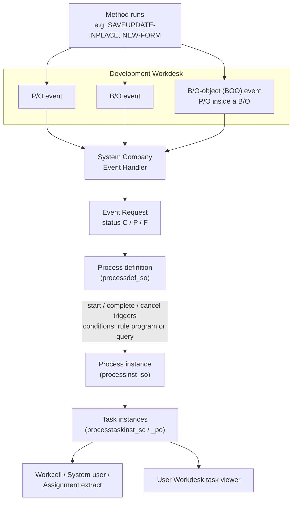

# 08 - Workflow (Process Control)

Source: *workflow setup.pdf* - "Process Control (Workflow) Event and Process Setup", Sherwood International Incorporated, version 1.0, first draft for **Release 6.1**, dated July 9, 2003, 33 pages. The PDF is scanned images; this text was recovered with OCR and screen-label spellings are approximate. Also developer help *Workflow Engine* and *Workflow Console*, and core tables page 32.

## 1. Model

Workflow is **event driven**. Developers define **events** on objects. An event fires when a chosen method runs (optionally filtered by field changes). A **system company event handler** writes the event to the **event request** queue. **Workflow processes** are triggered by those events, start tasks, assign them to people and model the order of tasks.

## 2. System Company: Event Handler

Maintained under System Company. Fields: Handler ID, description, **Override Processing** (allows writing events elsewhere), **Event Creation Program** (used when overriding), Log File, Debug On (the last two marked not in use). Use **Batch Process Link** > New to attach a batch process (search lists defined batch processes with status) that processes the events.

## 3. Defining events in the Development Workdesk

Select the object, open the **Events** tab, click New.

| Level | Where | Event name uniqueness |
|---|---|---|
| **Primary Object event** | P/O definition | unique within the P/O |
| **Business Object event** | B/O definition (selecting a view limits scope) | unique within the B/O |
| **B/O-Object (BOO) event** | A P/O as attached to a B/O (the context-specific instance of the P/O) | unique within the BOO |

Event definition:

| Field | Meaning |
|---|---|
| Event Name | Identifier |
| Event Type | "Field Change" (selection required but not used) |
| Description | Free text |
| Field Change | Triggered on field changes; use the check-mark icon to pick fields. Fields come from the object's tables (for example P/O `basevehicle_po`, B/O `quote_object` and `business_object_instance`) |
| **Event Method Triggers** (New) | Method (for example `SAVEUPDATE`), Style (`INPLACE`, `FORM`), **Trigger Before Running Method?**, **Trigger only on Success**, Wait for Event to be Processed (not in use), Trigger Order (not in use; will order events when several are defined) |

Examples shown in the document: P/O `BASEVEHICLE` with `SAVEUPDATE-INPLACE` (event on annual driving, etc.); B/O view `BASEAUTOQUOTE` event `NewSubmission` triggered on `SAVEUPDATE-INPLACE`; BOO `BASEAUTOQUOTE` / `BASEVEHICLE` triggered on `NEW-FORM`. Object model in the screenshots (Sherwood Auto Quote): `ADDRESS`, `BASEAUTOINFO`, `INSURED`, `PRODUCER`, `AGENT`, `ENTITYLOCATION`, `INSURERLINK`, `COVERAGE`, `ENDORSEMENT`, `BASEVEHICLE`, `BASEDRIVER`, `AUTOPOLICYCLAIM`.

## 4. Event Request Console

Lists every submitted event with handler, status, link item, user, event date. Status: **C** completed, **P** pending, **F** failed. Initial status is pending. Filter by handler and status.

## 5. Workflow Process Definition (`processdef_so`)

| Field | Meaning |
|---|---|
| Process ID, Description, Details | Unique name and text |
| Default Active / Warning / Due days | Days after creation when the task appears (black), warns (black), becomes overdue (red) |
| Default Priority | Unassigned, Very Low, Low, Normal, High, Very High, Urgent |
| Rule Program | Optional custom processing |
| Process Type | Process, Follow Up, or Check List |
| Allow Manual Start / Cancel / Complete | Whether a user may do so |
| Object Type | The B/O or S/O the process belongs to. Events must already exist on the object or they cannot be selected later |

### Process triggers

Define what **starts, completes or cancels** the process (several of each type allowed). Each trigger: type, description, conditional?, condition by **Rule Program** or **Query Condition** (user condition is not valid on triggers), and a **selected event**. Event selection modes: Business Object (events at B/O level), BO View (events of a view), Primary Object (events defined at P/O and BOO level). Only one event per trigger. Currently only Business Object events are available for system/business object selection.

### Query conditions

Built with the same query tree as CIM: AND/OR join type, event field, operator (begins, equals, greater than, less than, not begins, not equals, not greater than, not less than), value, data type, display format; toolbar for sub-expression, expression, delete, toggle And/Or, view as English string, rebuild tree.

## 6. Process tasks (`processtasksdef_sc`)

Each process has one or more tasks. A task is assigned to one of: **Workcell** (`workcell_so` with `cellworker_sc` members), **System User**, or **System Company Assignment Extract** (a component that computes the assignee, for example producer-based extract resolving to the right workcell).

| Field | Meaning |
|---|---|
| Task ID, Description, Details | Identity |
| Task Assigned | Shows target; change through Select |
| Execute Type | **Automatic** (method runs automatically), **Manual Trigger** (method runs when the user chooses "run task" on the workdesk) |
| Task Type | Checklist, Diary, Follow-up (re-occurring) |
| Method Level, Method, Style, View Type | Method run for the task |
| Default Active / Due / Warning days, Default Priority | Timing and priority |
| Complete Type | Manual (user), Automatic, Trigger |
| Expiry Action | Complete or Re-occur |
| Auto Expire | Expires after due date |
| Auto Initiate | Starts when the process begins |
| Allow Manual Start / Cancel / Complete | User controls |

## 7. Process model (`processmodeldef_sc`, `processmodeldef_subsc`)

One model per process definition, drawn with the flowchart control. Each step links a parent task to a child task. Solid line = unconditional; broken line = conditional. Step fields: relationship description, details, **Conditional?**, **Condition By**: *User* (user prompted to execute), *Rule* (rule program from process definition), *Object Event* (waits for an event on the task). Toolbar: new step, open, view, delete. The example process "newQuote" has START plus four tasks (`Process_1` to `Process_4`; their assignees appear to be a producer extract, a test assignment extract, an internal adjuster workcell and an Acme claim user, per OCR).

## 8. Runtime data

| Table | Role |
|---|---|
| `processdef_so`, `processmodeldef_*`, `processtasksdef_sc` | Definitions |
| `processinst_so` | Process instance with created/active/warning/due/completed timestamps, priority, status, created_by |
| `processtaskinst_sc` / `processtaskinst_po` | Task instance with timestamps, linked B/O (`task_bonum`, `task_boseq`, `task_boobjectnum`), `locked_by`, position (x, y), status, method/style, schedule fields (recurring, interval, working-day), `datakey1/2`, `task_boid`, `task_boview` |
| `workcell_so`, `cellworker_sc` | Work groups and members (`supervisor`, `auditworkcell`) |

The **Workflow Console** (Workflow Administration module) queries the Case Manager in real time for all processes and tasks and configures workcells, users and routing rules. The user's **task viewer** is the main page of the Workdesk.

## 9. Observations *(inferred)*

- Events are declarative triggers on method execution, so workflow coupling depends on method names and styles; renaming a method breaks event definitions.
- "Wait for Event to be Processed" and "Trigger Order" are present in the UI and tables but marked not in use in this release.
- The document is a **first draft**; screens may differ in released versions.
