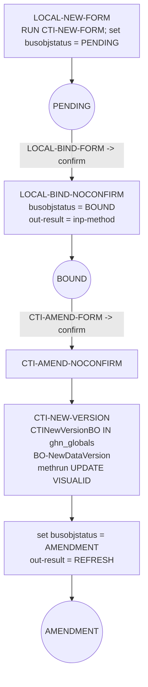

# 10 - Sample Code and Object-Definition Catalogue

All files are under `FrontTier Technical Training\`. Each entry says what the file does, what it depends on, and any defect found while reading it. Defects matter because the samples are the only executable code in the share and they are likely to be copied.

## 1. Architecture Overview

| File | Type | Description |
|---|---|---|
| `tquote_bo.df` | Progress schema (`ADD TABLE`) | Table `tquote_bo`, area `busdata`, description "Very simple quote object", dump name `tquote_b`. 9 fields (see [03](03-data-model.md)), indexes `newprimary` (unique primary), `effective_date`, `quote_number`; area `busindex`; code page ISO8859-1. `company` is `MANDATORY`. |
| `tdriver_po.df` | Schema | Table `tdriver_po` "Basic driver info; my first PO.", dump name `tdriver_`; 14 fields (`businessobjectnum`, `busobjsequence`, `objectnum`, `company`, `change_date`, `current_status`, `description`, `driver_name` x(100), `driver_license`, `license_class`, `license_year`, `license_month`, `license_province`); unique primary index on the three key fields. |
| `tvehicle_po.df` | Schema | Table `tvehicle_po` "Basich vehicle info" (typo in source), dump name `tvehicle`; fields as above with `vehicle_year`, `vehicle_make`, `vehicle_model`; unique primary index on three keys. |
| `tquote_bo.p` | 4GL method library (AppBuilder UIB v8r12) | Method procedure for B/O `TQUOTE` (header "pbm-TQUOTE.p"). Definitions: `bo-dialog = "dbm_tquote.w"`, `search-dialog = ""`, `bo-window = "wbm-generic_bo.w"`, `bo-desc = "TQUOTE"`, `BO-OBJECT = tquote_bo`, `BO-DISPLAY = 'Quote:' + tquote_bo.quote_number`. Includes `i-global.i`, `definput.i`, `objfunct.i`, `bo-stdmethod.i`, `bomain.i`. Internal procedures (each guarded by `&IF DEFINED(EXCLUDE-...)`): `CTI-AMEND-FORM`, `CTI-AMEND-NOCONFIRM`, `CTI-NEW-VERSION`, `LOCAL-BIND-FORM`, `LOCAL-BIND-NOCONFIRM`, `LOCAL-NEW-FORM`. See section 5. |
| `pstrtquote.p` | Launcher | Calls `{methrun.i &OBJECT-TYPE='B/O' &OBJECT-ID='TQUOTE' &BO-VIEW='' &METHOD='SEARCH' &METHOD-STYLE='TREEVIEW'}`. Registered as the target of the "TQUOTE Administration" menu item. |
| `L00`-`L07` `.doc` | Lecture/lab text | Summarised in [05](05-development-guide.md). `Lab Template.doc` is empty (34 characters). |
| `FronTier Architecture and Object Definitions.doc` | Lecture | Section "System Objects / System Object Definitions" at the end is an empty heading; the system component tables listed are `component_classes`, `component_type`, `component_definitions`, `sysobject_properties`, `component_definitions_methods`, `component_programs` (the last is `comp_programs` in the schema). |
| `Method Broker.doc`, `Methrun Parameters.doc` | Reference | Same content as L08 (see [04](04-method-broker.md)). `Methrun Parameters.doc` exists in both folders with identical size. |
| `All FronTier Core Tables.pdf`, `Business Object Architecture Tables.pdf`, `System Object Architecture Tables.pdf` | Schema diagrams | Source of [03](03-data-model.md). |
| `developerhelp.chm` | Compiled help, 380 files | The FRONT-TIER developer help (Concise Technologies Inc.). Source of [01](01-system-overview.md), [04](04-method-broker.md), [06](06-business-modules.md), [09](09-api-reference.md). Contains GIF diagrams not reproduced here. |
| `tquote.vsd`, `Training BO LifeCycle.vsd`, `Training Object Model.vsd` | Visio drawings | Not extractable with the tools available (see [12](12-source-inventory-and-gaps.md)). Their subjects are the quote model, the BO lifecycle (Lab 6) and the object model (L00). |

## 2. `objdef` export package (company `SSQ`, class `TAUTO`)

The folder is an **object export package**: an index XML, one XML per object, and one `.def` data file per repository table.

| Package id | Object | XML records | Repository tables exported |
|---|---|---|---|
| `botquote_v1` | B/O `TQUOTE` seq 1 | `botquote_v1.xml` | 14 tables: `ba_meta_field` (44), `ba_meta_table` (6), `business_definitions_methods` (28), `business_definitions_status` (3), `business_object_classes` (1), `business_object_definition` (1), `business_object_objects` (2), `business_object_programs` (4), `business_object_type` (1), `business_status_methods` (10), `business_status_obj_methods` (18), `image_table` (19), `object_properties` (1), `standard_images` (10) |
| `potdriver_v1` | P/O `TDRIVER` | `potdriver_v1.xml` | `ba_meta_field`, `ba_meta_table`, `image_table`, `object_classes`, `object_definitions`, `object_definitions_methods`, `object_programs`, `object_type`, `standard_images` |
| `potinsurer_v1` | P/O `TINSURER` | as above | same set |
| `potvehicle_v1` | P/O `TVEHICLE` | as above (field/table counts 23 and 4) | same set |
| `objectpackage.xml` | package index | | Lists `TDRIVER`, `TINSURER`, `TVEHICLE` (PO) and `TQUOTE` (BO) with `OBJECT-ORIGIN="SELECTED"`, `OBJECT-COMPANY="SSQ"`, `EXPORT-LOCATION="C:\ft\dev\ssq\objdef\"` |

File naming: `<package>` + abbreviated table name, for example `botquote_v1bodefmet.def` = `business_definitions_methods`. Each `<DATA>` element in the XML carries `DB-NAME="frontier"`, `SCHEMA-CRC` (a checksum of the target table's schema, used to detect incompatible imports), `RECORD-COUNT` and `DEFINITION-FILE`.

`.def` files are Progress `EXPORT` format (quoted strings, space delimited), one row per repository record.

### Decoded content

**`TQUOTE` methods** (`botquote_v1bodefmet.def`, 28 rows). Row layout begins: company, B/O id, sequence, view, method, style, procedure name, description, then flags (visual, default, persistent, ...), `style_status` ("Active"), `db_activity`, `procedure_type` ("External"), parameter type, menu flag, `valid_status`, menu label, images, menu order, `changestatusto`, method record id, and toolbar/tooltip fields. Procedure column is `tquote.p` for most, blank for those handled by `bo-stdmethod`.

**`TQUOTE` statuses** (`bodstatu`): `/LINK`, `/UPDATE`, `ACTIVE`. **Status methods** (`bostatme`): `/LINK`: `OPEN-TREEVIEW`; `/UPDATE`: `CANCELUPDATE-INPLACE`, `SAVEUPDATE-INPLACE`; `ACTIVE`: `AUDIT-FORM`, `DELETE-FORM`, `DELETE-INPLACE`, `NEW-FORM`, `OPEN-FORM`, `OPEN-INPLACE`, `SELECT-DIALOG`.

**`TQUOTE` programs**: see [05](05-development-guide.md) section 4. **Definition** (`busobjde`): valid `09/18/02` to `01/01/9999`, description "Training BO Quote", standard image "Quote", data table `tquote_bo`, `version_data` no in this export.

**CIM schema extensions for `TQUOTE`** (`bametatb`, `ba_meta_table`, 6 rows; `bametfie`, `ba_meta_field`, 44 rows with attribute names, display order, data type and format). Attribute names and relationships:

| Physical table | Attribute | Parent | Main | Relationship |
|---|---|---|---|---|
| `business_object_instance` | `business_object_instance` | - | no | - |
| `tquote_bo` | `TQUOTE` | `business_object_instance` | **yes** | One |
| `business_object_totalprem` | `TOTALPREMIUM` | `business_object_instance` | no | None or One |
| `business_object_premium` | `PREMIUM` | `business_object_totalprem` | no | None or One |
| `business_object_premsummary` | `PREMIUMSUMMARY` | `business_object_totalprem` | no | None, One or Many |
| `business_object_premdetail` | `PREMIUMDETAIL` | `business_object_premium` | no | None, One or Many |

`object_properties` row `CompareFields` = `!businessobjectnum,!busobjsequence,!change_date,!company,!current_status,*` with property type `MainTable` (field list, in `CAN-DO` syntax; presumably used by the `DIFF` method to compare versions *(inferred)*). `standard_images` maps `Quote`, `Cancel`, `Delete`, `View`, `Help`, `New`, `Open`, `Open Link`, `Save`, `Find` to image-catalogue keys (16 and 32 pixel, sensitive and insensitive).

**Attachments** (`busobjob`): `ATTACHMENTS` seq 2 and `NOTES` seq 5, valid `01/01/1900`-`01/01/2999`, relationship "None, One or Many", valid view list `,SYSTEMCOMPANY,COMPANY` (the P/Os' own views), with status methods for each (`AUDIT-FORM`, `DELETE-*`, `NEW-FORM`, `OPEN-*`, `VIEW-FORM`, `/UPDATE` save/cancel).

**`TINSURER`** (`potinsurer_v1obdefmet.def`; the XML declares 27 records, 26 distinct method/style rows were identified): the link-style P/O set: `ADDLINK-DIALOG`, `ADDLINK-NOCONFIRM`, `AUDIT-FORM`, `CANCELLINK-INPLACE`, `CANCELUPDATE-INPLACE`, `CHANGELINK-DIALOG`, `COPY-NOCONFIRM`, `DELETE-{FORM,INPLACE,JSP,NOCONFIRM}`, `DIFF-NOCONFIRM`, `GETATTRIB-NOCONFIRM`, `HELP-DIALOG`, `NEW-{FORM,JSP,NOCONFIRM}`, `NEWVERSION-NOCONFIRM`, `OPEN-{FORM,INPLACE}`, `SAVELINK-INPLACE`, `SAVEUPDATE-{INPLACE,JSP}`, `SYSATTRIB-NOCONFIRM`, `UPDATE-NOCONFIRM`, `VIEW-FORM`. Compared with a data-bearing P/O it adds the `*LINK*` methods.

## 3. The Method Broker folder

| File | Description |
|---|---|
| `demo-methrun.p` / `.d` / `.doc` | Batch loader driven by a comma-delimited file. Skips the header line, then for each row: find or create quote (`TQUOTE` `NEW-NOCONFIRM` plus `UPDATE-NOCONFIRM` `VISUALID`), find or create vehicle (`TVEHICLE` `NEW-NOCONFIRM`, parent `INPUT-ROWID-C` = quote BOI), find or create driver (`TDRIVER`, parents `INPUT-ROWID-B` = vehicle BOOI and `INPUT-ROWID-C` = quote BOI). Each creation is in its own `DO TRANSACTION`. Data file columns: `TQUOTE Number,TVEHICLE Make,TVEHICLE Model,TVEHICLE YEAR,TDRIVER Driver NAME`; sample rows: quote 1 Honda Civic 2000 / Honda Accord 2002 with driver SSQ, quote 2 Ford F150 2003 with drivers Sherwood, Randy, Dan. The `.doc` is the same description. |
| `meth_createbo.p` | `TQUOTE` `NEW-NOCONFIRM`, then sets `quote_number = 'Test-2'`, `effective_date = TODAY`, `expiry_date = 09/25/2003`. |
| `meth02_bovisualid.p` | Finds quote `Test-2`, sets `description = 'Manual update'` and calls `UPDATE-NOCONFIRM` with `VISUALID` to refresh the visual id. |
| `meth02_createvehiclepo.p` | Creates a `TVEHICLE` under `Test-2` and, on success, a `TDRIVER` under that vehicle. |
| `meth03_createinsurer.p` | Finds `entity_bo` name beginning `Sherwood International Inc` that has an `INSURER` row in `business_object_inst_view`, then creates a `TINSURER` P/O on `Test-2` linked to that ENTITY (`INPUT-LINKLEVEL='B/O'`, `INPUT-LINKVIEW='INSURER'`). |
| `meth04_deleteinsurer.p` | Finds the `TINSURER` BOOI of `Test-2` and deletes it with `DELETE-NOCONFIRM`. |
| `Coding Guidelines for FrontTier Methods.doc` | See [04](04-method-broker.md). |
| `L08 - Common Method Calls.doc`, `Methrun Parameters.doc`, `FronTier Architecture and Methods.doc` | The last is only a title page ("Technical Description of how the FrontTier Method Broker Interacts with Objects", Sept 2002, overview heading with no body). |

## 4. Queries and CIM

| File | Description |
|---|---|
| `Queries/boquery.p`, `Queries/botolinkedbo.p` | **Identical files** (970 bytes). Finds drivers whose name begins `Michael`, joins to the P/O's BOOI (`objecttypeid='TDRIVER'`), then BOI where `businessobjectid='TQUOTE'`, then `tquote_bo`, and displays driver name and quote number once per business object (`FIRST-OF businessobjectnum`). `botolinkedbo.p` was presumably meant to demonstrate the B/O to linked-B/O walk (Lab 7 last exercise) but contains the `boquery.p` content. |
| `CIM/mapping.p`, `mapping_so_extract.p`, `mapping_tquote_extract.p` | See [07](07-cim-and-reporting.md). |

## 5. `tquote_bo.p` lifecycle logic

### Defects and risks found in the samples

| # | File | Finding | Impact |
|---|---|---|---|
| 1 | `tquote_bo.p` `CTI-NEW-VERSION` | After the successful `mainBlock`, execution falls through to `ASSIGN out-result = "Unexpected error creating new version". RETURN "ERROR".` There is no `RETURN` inside the block. | The procedure always returns `ERROR`; `CTI-AMEND-NOCONFIRM` only works because it ignores the return value and reads `out-rowida`. |
| 2 | `tquote_bo.p` `CTI-AMEND-NOCONFIRM` | Calls `RUN CTI-NEW-VERSION` and does not check `RETURN-VALUE`/`out-result`; no explicit transaction block; `CTI-AMEND-FORM` and `LOCAL-BIND-FORM` call the NOCONFIRM procedure with `RUN`, no hourglass and no result dialog. | Violates the guidelines in [04](04-method-broker.md) (no atomicity, no user feedback, errors lost). |
| 3 | `tquote_bo.p` `CTI-NEW-VERSION` | `methrun` for `UPDATE` passes `&ASOF = CTISessionDate()` and its result is not checked. | Failure of the visual-id update goes undetected. |
| 4 | `demo-methrun.p` | `business_object_instanc.businessobjectnum` (truncated table name) in the vehicle search. | Compile error. |
| 5 | `demo-methrun.p` | Driver search uses `objecttypeid = "TDRIVEFR"`. | Never finds an existing driver, so duplicates are created on re-run. |
| 6 | `demo-methrun.p` | Assigns `tquote_bo.jurisdiction = "PQ"` but `tquote_bo.df` has no `jurisdiction` field. | Compile error against the training schema; the sample was written for a different schema. |
| 7 | `demo-methrun.p`, `meth_createbo.p` | Success is tested by `RETURN-VALUE = "METHOD-ERROR"` / `out-result = "CANCEL"` and errors are shown with `MESSAGE ... ALERT-BOX`. | Contradicts the guideline that non-visual code must use `ERROR` and no UI. |
| 8 | `demo-methrun.p` | Vehicle and driver are created in separate transactions. | Partial quote on failure; the lab asks for all-or-nothing. |
| 9 | `meth04_deleteinsurer.p` | References `tquote_bo.businessobjectnum` in a `FIND` before testing `AVAILABLE tquote_bo`. | Runtime error when the quote does not exist. |
| 10 | `boquery.p`, `botolinkedbo.p` | Join `business_object_obj_inst.databusinessobjsequence = tdriver_po.busobjsequence` starting from the P/O data table. | The architecture guide says never to join from P/O data back to BOOI (many-to-one). Works for the training data but can miss or duplicate rows across versions. |
| 11 | `meth_createbo.p` | `DATE('09/25/2003')` depends on `-d` session date format. | Environment-dependent. |
| 12 | `Coding Guidelines` non-visual template | Uses `localinp-method`/`localinp-style` while the declared prefix is `child`. | Compile error if copied verbatim. |
| 13 | Package `botquote_v1` | `business_object_objects` holds only `ATTACHMENTS` and `NOTES`. | The Lab 4 structure (`TVEHICLE`, `TDRIVER`, `TINSURER` and the ENTITY link) is not in the export; importing it elsewhere would not reproduce the training model. |
| 14 | Package `botquote_v1` / Lab 6 | The exported `business_object_definition` row has `version_data` = no, `track_premium` = no and `autonewversion` = no (positions read against the schema field order). Lab 6 does not tell the student to enable them, while the architecture document says both *Version Data* and *Auto New Version* must be on for versioning. | `CTINewVersionBO` may not produce versioned data records as the lab expects. Verify the flags in the target environment. |
